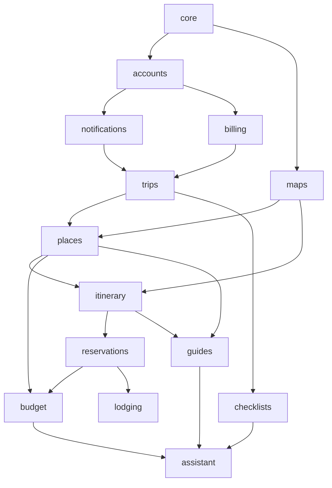

# Piano di implementazione — WANDERLOG (Django)

**Versione:** 2.9 (revisione del `plan.md` generato da GitHub Copilot)
**Base:** [specifiche funzionali v1.2](specifiche-funzionali.md) (1 novembre 2026)
**Riferimenti:** «spec §N» indica la sezione N delle specifiche funzionali; «§N» da solo indica una sezione di questo piano.
**Destinatario:** team di 5 persone e GitHub Copilot in modalità Agent
**Data:** 4 novembre 2026

**Changelog 2.9 (4 novembre 2026).** Nessun requisito nuovo e nessun task cambiato. Solo collegamenti: i rimandi ai punti di [spec §15](specifiche-funzionali.md#15-criteri-di-accettazione-del-primo-rilascio) e [spec §18](specifiche-funzionali.md#18-decisioni-ancora-aperte) portano al punto preciso dell'elenco; i codici dei requisiti portano alla loro riga nelle specifiche; i riferimenti «§N» a questo piano portano alla sezione. Cinque formulazioni diventano «elencate in spec §N» (o «elencati»): tre volte [spec §6](specifiche-funzionali.md#6-modello-informativo), una [spec §15](specifiche-funzionali.md#15-criteri-di-accettazione-del-primo-rilascio), una [spec §16](specifiche-funzionali.md#16-fuori-ambito-della-prima-versione).

**Changelog 2.8 (4 novembre 2026).** Nessun requisito nuovo e nessun task cambiato. Ogni riferimento «§» dice a quale documento rimanda: «spec §N» per le specifiche funzionali, con un link alla sezione; «§N» da solo per questo piano. Aggiunta una nota sulla colonna "Fonte" del [§4](#4-decisioni-aperte).

**Changelog 2.7 (1 novembre 2026).** Nessun requisito nuovo. Si chiariscono i proprietari dei requisiti, approvato da Mauro Spinarelli il 1/11/2026, con una regola: **ogni requisito appartiene al workstream che possiede l'app in cui vive il suo codice** ([§3](#3-workstream-del-team-5-persone-ribilanciati)).

- [COL-06](specifiche-funzionali.md#col-06) (= [NEW-10](specifiche-funzionali.md#new-10)) passa a C (`places`). [TRP-11](specifiche-funzionali.md#trp-11) (diario di base) e [TRP-14](specifiche-funzionali.md#trp-14) passano a E (`guides`); B fornisce i servizi e gli eventi di `trips` che servono. TRP-11 di base entra nel blocco 1B di E.
- [MAP-06](specifiche-funzionali.md#map-06) condiviso tra C ed E, con i file di ciascuno indicati ([§3](#3-workstream-del-team-5-persone-ribilanciati)).
- Task 0.9: proprietario A, con C per l'isola della mappa e la sua parte della pagina di prova. Fase 1C: `seed_demo` e test e2e a B. Export JSON più allegati: A, in `accounts` (chiude il [§21](#21-dettagli-da-concordare), punto 20). Produzione ([§21](#21-dettagli-da-concordare), punti 52-62): A, con i contributi di tutti.
- [OFF-01/02](specifiche-funzionali.md#off-01) a B, API per l'app (D12, CORS) ad A, [EXT-01](specifiche-funzionali.md#ext-01) a C, [EXT-02](specifiche-funzionali.md#ext-02) a E, [NEW-09](specifiche-funzionali.md#new-09) ad A.
- Nuovi task preparatori in parallelo alla Fase 1A: 1A.6 (D: fixture `.eml` e test dei parser) e 1A.7 (E: contenuti originali di guide e checklist).
- [§15](#15-mappatura-completa-requisito--fase): nuova colonna "Flusso"; nota di [ACC-05](specifiche-funzionali.md#acc-05) corretta (bozza nella sessione). [§16](#16-regole-di-collaborazione): nomi dei branch confermati (`feat/places`, `feat/reservations`, `feat/guides`). [§11](#11-strategia-di-test): copertura minima 80% su tutte le 14 app.
- Tolto il residuo `django_vite` dal task 0.3.

**Changelog 2.6 (1 novembre 2026).** Nessun requisito nuovo. D2 è decisa: cambia il frontend della Fase 0 e della Fase 1.

- **D2 decisa da Mauro Spinarelli il 1/11/2026:** template Django + HTMX, con un'"isola" JavaScript solo per la mappa interattiva (Leaflet o il JavaScript del provider scelto in D1, caricato solo nelle pagine con mappa; finché D1 è aperta il provider è `mock`). React è escluso dalla Fase 1; si potrà riconsiderare per l'app della Fase 2, che usa l'API DRF.
- Tolti i marcatori [SPA] e ciò che valeva solo con l'opzione A: `django-vite` ([§8](#8-requirements)), servizio `vite` ([§9](#9-compose-sviluppo)), passi npm della CI (0.8), client TypeScript ([§11](#11-strategia-di-test)), i18next ([§13](#13-i18n-e-accessibilità-fase-1-non-rimandabili)), `frontend/` ([§3](#3-workstream-del-team-5-persone-ribilanciati), [§16](#16-regole-di-collaborazione), [§17](#17-rischi-principali)), righe Node del `.gitignore` (0.1), origine `http://localhost:5173` del server Vite da `CSRF_TRUSTED_ORIGINS` ([§10](#10-envexample-nuovo-file-nella-radice)).
- Riscritti [§2](#2-approccio-generale-confermato-dal-piano-originale-con-correzioni) (frontend), [§4](#4-decisioni-aperte) (D2), task 0.9 e il checkpoint finale della Fase 0; nuove righe nel [§11](#11-strategia-di-test) (viste e partial HTMX) e nel [§12](#12-sicurezza-e-privacy-spec-12-13) (CSRF con HTMX); riordino da tastiera nel [§13](#13-i18n-e-accessibilità-fase-1-non-rimandabili) senza `@dnd-kit`.
- Adattati a D2, come *Decisione proposta*: annulla e ripeti di [TRP-12](specifiche-funzionali.md#trp-12) (pila lato server invece che lato client) e bozza del visitatore di [ACC-05](specifiche-funzionali.md#acc-05) (sessione Django invece di `localStorage`).
- [§21](#21-dettagli-da-concordare): aggiornati i punti 16, 22, 23 e 24; nuovo [§21.11](#2111-frontend-d2) "Frontend (D2)".

**Changelog 2.5 (1 novembre 2026).** Nessun requisito nuovo e nessun task cambiato.

- Nuovo [§21](#21-dettagli-da-concordare) "Dettagli da concordare": le scelte tecniche che specifiche e piano non fissano, raccolte dalle dispense del corso (5-11, 13-15) e raggruppate per area, ciascuna con il default usato negli esempi e il task a cui serve.

**Changelog 2.4 (1 novembre 2026).** Nessun requisito nuovo e nessun task cambiato.

- Base aggiornata alle specifiche v1.2, che risolvono le incongruenze elencate nella 2.3.
- [§20](#20-incongruenze-risolte) diventa "Incongruenze risolte": per ogni punto la decisione e dove è stata corretta. Visibilità a quattro livelli decisa da Mauro Spinarelli il 1/11/2026.

**Changelog 2.3 (1 novembre 2026).** Nessun requisito nuovo; si corregge la Fase 0 perché ogni checkpoint possa passare.

- Fase 0 riordinata: prima `.gitignore` e ambiente (0.1), poi dipendenze e immagine (0.2), poi custom user e registrazione delle app (0.3), poi Celery e servizi del compose (0.4). Le app di terze parti entrano in `INSTALLED_APPS` solo dopo essere installate. I task successivi scalano di uno (0.5–0.9).
- Configurazione di django-allauth allineata alla documentazione ufficiale: `AccountMiddleware`, `AUTHENTICATION_BACKENDS`, impostazioni per un utente senza username. `django.contrib.sites` e `SITE_ID` non servono. `ASGI_APPLICATION` impostato insieme a `daphne`.
- `User` con chiave primaria UUID, decisa prima della prima migrazione ([§5](#5-modello-dati)).
- `.gitignore` creato per primo nel task 0.1, con checkpoint `git check-ignore`.
- `env_file: .env` del compose anticipato al task 0.1, insieme alla lettura delle variabili in `settings.py`.
- Checkpoint su `git grep` riscritto: esce con 0 quando il controllo passa ([§0](#0-istruzioni-per-github-copilot-modalità-agent), istruzione 2).
- Variabili email allineate: `EMAIL_HOST` e `EMAIL_PORT`; nel compose spariscono `MAILPIT_HOST` e `MAILPIT_PORT`.
- Nuovo [§20](#20-incongruenze-risolte): incongruenze nelle specifiche da chiarire. Le specifiche non cambiano.

La 2.1 non aggiunge requisiti. Registra due comportamenti visti sull’editor di riferimento il 31 ottobre 2026, già coperti da [PLC-06](specifiche-funzionali.md#plc-06), [TRP-12](specifiche-funzionali.md#trp-12), [ITN-01](specifiche-funzionali.md#itn-01) e [ITN-03](specifiche-funzionali.md#itn-03): lo spostamento di un luogo dalla lista a un giorno resta dopo un reload, e la tratta compare nel gesto, non in un job successivo. Non si copia lo schema né le API di quel prodotto.

La 2.2 confronta [PlaneIT.docx](PlaneIT.docx) con questo piano. Quel file non sostituisce le specifiche: il dettaglio è al [§19](#19-planeitdocx).

Convenzioni del documento:

- Gli ID tra parentesi ([ACC-01](specifiche-funzionali.md#acc-01), [TRP-05](specifiche-funzionali.md#trp-05), …) e i riferimenti `spec §n` rimandano alle specifiche. Non ci sono requisiti inventati.
- Le scelte tecniche che non vengono dalle specifiche sono marcate **Decisione proposta**. Si possono cambiare, ma vanno cambiate qui prima di scrivere codice.
- Le scelte che bloccano una fase sono marcate **Decisione aperta Dn** (elenco completo al [§4](#4-decisioni-aperte)).
- I percorsi sono relativi alla **radice del repository** `WANDERLOG/` (la cartella che contiene `compose.yaml`).
- I comandi di checkpoint si eseguono dalla radice del repository. Su Windows PowerShell usare `curl.exe` al posto di `curl`.

---

## 0. Istruzioni per GitHub Copilot (modalità Agent)

1. Esegui **un task alla volta**, nell'ordine delle fasi. Non iniziare un task se il checkpoint della fase precedente non passa.
2. Prima di chiudere un task esegui i comandi del suo checkpoint e riporta l'output. Un task è finito solo se **tutti** i comandi escono con codice 0 e i criteri sono veri.
3. Non rigenerare il progetto: **non** eseguire `django-admin startproject` né `startapp` per le app già esistenti ([§1](#1-stato-reale-del-repository-punto-di-partenza)).
4. Ogni modello nuovo nasce nell'app indicata al [§5](#5-modello-dati). Ogni modifica di modello è accompagnata dalla sua migrazione (`makemigrations <app>`), e `makemigrations --check --dry-run` deve risultare pulito.
5. Rispetta il grafo delle dipendenze ([§6](#6-grafo-delle-dipendenze-tra-app)): un'app non importa mai un'app che sta sopra di lei. Il controllo è automatico (`lint-imports`).
6. Ogni endpoint nuovo ha test di permesso secondo la matrice del [§7](#7-matrice-dei-permessi).
7. Ogni stringa visibile all'utente è marcata per la traduzione (`gettext` / `t()`), con testo in italiano e in inglese.
8. Non scrivere segreti nel codice e non fare commit di `.env`. Le chiavi esterne si leggono da variabili d'ambiente ([§10](#10-envexample-nuovo-file-nella-radice)). Senza chiave si usa il provider `mock`.
9. Se un task richiede una decisione aperta non ancora presa ([§4](#4-decisioni-aperte)), fermati e segnalalo. Non scegliere al posto del team.
10. `docs/PlaneIT.docx` non è una specifica di implementazione. Non aggiungere i suoi campi account, la splash animata né gli endpoint di login descritti lì ([§19](#19-planeitdocx)).

---

## 1. Stato reale del repository (punto di partenza)

```
WANDERLOG/                      # radice git
├── compose.yaml                # django, db (postgres:17), redis, mailpit (axllent/mailpit)
├── Dockerfile                  # python:3.12-slim, WORKDIR /app/WANDERLOG, runserver
├── requirements.txt            # Django>=5.2,<5.3, psycopg[binary], dj-database-url, redis, celery
├── .dockerignore               # non esiste .gitignore
├── docs/
│   └── specifiche-funzionali.md
└── WANDERLOG/                  # progetto Django (contiene manage.py)
    ├── manage.py
    ├── WANDERLOG/              # package di configurazione
    │   ├── settings.py         # DATABASES via dj_database_url.config(...)
    │   ├── urls.py, asgi.py, wsgi.py
    ├── accounts/  assistant/  billing/  budget/  checklists/  core/  guides/
    └── itinerary/ lodging/  maps/  notifications/  places/  reservations/  trips/
```

Cosa manca oggi e va sistemato nella Fase 0:

- Le 14 app esistono (`models.py` vuoti, cartelle `migrations/` vuote) ma **non sono in `INSTALLED_APPS`**.
- **Non esiste un custom user model.** Va creato **prima del primo `migrate`** delle app.
- `settings.py` ha `SECRET_KEY` e `DEBUG = True` scritti nel codice e `ALLOWED_HOSTS = []`. La variabile `DEBUG` passata dal compose viene ignorata. `LANGUAGE_CODE = "en-us"`.
- Il compose non ha un worker Celery né beat. Non c'è `.env.example`.
- **Non esiste `.gitignore`.** Va creato prima di qualsiasi `.env`, ambiente virtuale o file generato (task 0.1).
- Il compose passa le variabili con un blocco `environment:`; per l'email usa `MAILPIT_HOST` e `MAILPIT_PORT`, nomi che `settings.py` non legge. Il piano usa i nomi delle impostazioni Django, `EMAIL_HOST` ed `EMAIL_PORT` ([§10](#10-envexample-nuovo-file-nella-radice)).
- Le dipendenze per API, realtime, login Google, immagini e test sono assenti.

**Decisione aperta D3 (raccomandazione: confermare).** Le app restano **nella radice del progetto Django** (`WANDERLOG/<app>/`), come sono oggi. Il piano di Copilot proponeva `apps/` + `config/settings/` divisi: questo piano **non** li adotta. Spostarle costerebbe un refactoring senza benefici funzionali, mentre `settings.py` unico, letto da variabili d'ambiente, basta. Se il team vuole comunque `apps/`, lo spostamento va fatto nel task 0.1, prima di qualsiasi migrazione.

**Decisione proposta.** Non creare un'app `web` (presente nel piano di Copilot, non in [spec §10](specifiche-funzionali.md#10-architettura-funzionale-django)): le pagine pubbliche generiche (home, pagine legali) vanno in `core`, quelle di destinazioni e guide in `guides`.

---

## 2. Approccio generale (confermato dal piano originale, con correzioni)

- **Monolite Django modulare.** Un'API REST unica per web e futura app ([spec §4.2](specifiche-funzionali.md#42-canali)): `/api/v1/` con Django REST Framework e drf-spectacular (OpenAPI). *Decisione proposta.*
- **Frontend (D2 decisa, 1/11/2026).** Pagine pubbliche (home, destinazioni, guide, luoghi, autenticazione, pagine legali) ed **editor del viaggio** con **template Django + HTMX**: le view restituiscono pagine intere o frammenti HTML (partial), che HTMX inserisce nella pagina. Il tempo reale usa l'estensione `ws` di HTMX: il consumer di Channels invia frammenti HTML.
  - **Isola JavaScript solo per la mappa interattiva:** Leaflet o il JavaScript del provider scelto in D1, caricato solo nelle pagine con mappa. Finché D1 è aperta il provider è `mock`. L'isola legge i dati dall'API `/api/v1/` con la sessione e la policy di sempre (*Decisione proposta*).
  - HTMX 2, la sua estensione `ws` e la libreria della mappa sono **file statici versionati** nel repository, senza Node né build (*Decisione proposta*).
  - **React è escluso dalla Fase 1.** Si potrà riconsiderare per l'app della Fase 2, che usa l'API DRF. L'API resta il contratto unico per web e app ([spec §4.2](specifiche-funzionali.md#42-canali)).
- **Adapter mappe** in `maps/`: interfacce `PlaceProvider`, `RouteProvider`, `Geocoder` e un `MockProvider` per sviluppo e test. **Attenzione:** a differenza del piano originale, il provider reale va scelto **prima dello schema di `places`** (Decisione aperta D1), perché la licenza limita cosa si può salvare ([spec §11](specifiche-funzionali.md#11-integrazioni), [spec §13](specifiche-funzionali.md#13-vincoli-legali-e-di-prodotto)).
- **Tempo reale ([COL-02](specifiche-funzionali.md#col-02), [spec §10](specifiche-funzionali.md#10-architettura-funzionale-django)):** Django Channels + `channels-redis`, un gruppo per viaggio. Il server è ASGI tramite `daphne`.
- **Task asincroni:** Celery con broker Redis (worker + beat), per parser email, notifiche, cambi valuta e, in Fase 2, stato voli e cali di prezzo.
- **i18n:** italiano e inglese dalla Fase 0 ([spec §4.1](specifiche-funzionali.md#41-principi) punto 6, [spec §12](specifiche-funzionali.md#12-requisiti-non-funzionali)).
- **Ambiente di sviluppo:** Docker Compose (già presente, da estendere al [§9](#9-compose-sviluppo)).

---

## 3. Workstream del team (5 persone, ribilanciati)

Rispetto al piano originale, `notifications` passa da B ad A e `checklists` da D a E, per alleggerire B (realtime) e D.

**Regola di proprietà (2.7):** ogni requisito appartiene al workstream che possiede l'app in cui vive il suo codice. Se il requisito usa i servizi di un'app più bassa, il proprietario di quell'app li fornisce (`services.py`, segnali, eventi) e li concorda con una issue ([§16](#16-regole-di-collaborazione)). La colonna "Flusso" del [§15](#15-mappatura-completa-requisito--fase) applica la regola a tutti gli ID.

| Dev | Workstream | App di proprietà | Requisiti principali |
| --- | --- | --- | --- |
| **A** | Piattaforma, account, notifiche, abbonamento | `core`, `accounts`, `notifications`, `billing` | Fase 0 (task 0.9 con C), [ACC-01..07](specifiche-funzionali.md#acc-01), [NEW-01](specifiche-funzionali.md#new-01), [OFF-03](specifiche-funzionali.md#off-03), [SUB-01..03](specifiche-funzionali.md#sub-01), [NEW-09](specifiche-funzionali.md#new-09), API per l'app (D12, CORS), export JSON più allegati, CI, sicurezza, produzione ([§21.10](#2110-produzione), con i contributi di tutti) |
| **B** | Viaggi e collaborazione | `trips` (+ realtime, attività, inviti, commenti) | [TRP-01..10](specifiche-funzionali.md#trp-01), [TRP-12](specifiche-funzionali.md#trp-12), [TRP-13](specifiche-funzionali.md#trp-13), [NEW-07](specifiche-funzionali.md#new-07), [NEW-11](specifiche-funzionali.md#new-11), [COL-01..05](specifiche-funzionali.md#col-01), [OFF-01](specifiche-funzionali.md#off-01), [OFF-02](specifiche-funzionali.md#off-02); Fase 1C: `seed_demo` e test e2e |
| **C** | Luoghi, mappa, itinerario | `maps`, `places`, `itinerary` | [PLC-01..09](specifiche-funzionali.md#plc-01), [MAP-01..07](specifiche-funzionali.md#map-01) ([MAP-06](specifiche-funzionali.md#map-06) con E), [ITN-01..10](specifiche-funzionali.md#itn-01), [NEW-03](specifiche-funzionali.md#new-03), [NEW-06](specifiche-funzionali.md#new-06), [NEW-08](specifiche-funzionali.md#new-08), [COL-06](specifiche-funzionali.md#col-06) (= [NEW-10](specifiche-funzionali.md#new-10)), [EXT-01](specifiche-funzionali.md#ext-01) (lato server); isola della mappa del task 0.9 |
| **D** | Prenotazioni e budget | `reservations`, `budget` | [RES-01..10](specifiche-funzionali.md#res-01), [BDG-01..08](specifiche-funzionali.md#bdg-01), [NEW-02](specifiche-funzionali.md#new-02), [NEW-04](specifiche-funzionali.md#new-04), [NEW-05](specifiche-funzionali.md#new-05); task 1A.6 |
| **E** | Scoperta, checklist, alloggi, assistente | `guides`, `checklists`, `lodging`, `assistant` | [GDE-01..09](specifiche-funzionali.md#gde-01), [CHK-01..04](specifiche-funzionali.md#chk-01), [HOT-01..07](specifiche-funzionali.md#hot-01), [AI-01..06](specifiche-funzionali.md#ai-01), [TRP-11](specifiche-funzionali.md#trp-11) (diario), [TRP-14](specifiche-funzionali.md#trp-14), [MAP-06](specifiche-funzionali.md#map-06) con C, [EXT-02](specifiche-funzionali.md#ext-02) (lato server); task 1A.7 |

Casi con più app (2.7):

- **[TRP-11](specifiche-funzionali.md#trp-11) e [TRP-14](specifiche-funzionali.md#trp-14) (E).** Il diario (`Journal`, `JournalStop`) e la conversione in guida stanno in `guides`. B fornisce da `trips` i servizi di lettura del viaggio, `record_activity` e gli eventi; la pagina del viaggio di `trips` porta alla vista diario con un link o la carica come partial con `hx-get`, senza importare `guides` ([§6](#6-grafo-delle-dipendenze-tra-app)).
- **[MAP-06](specifiche-funzionali.md#map-06) (C ed E).** C possiede in `maps/` il template incorporabile in sola lettura e lo script dell'isola (`maps/static/maps/`), che ricevono i dati e non conoscono le guide. E possiede in `guides/` la view, l'URL e il controllo che la guida sia pubblica, e passa i dati al template di `maps`.
- **Task 0.9 (A con C).** A possiede `core/templates/base.html`, i file statici di HTMX in `core/static/` e `core/tests/test_frontend.py`; C possiede l'isola in `maps/static/maps/` e, nella pagina di prova, il contenitore della mappa.
- **[OFF-01](specifiche-funzionali.md#off-01), [OFF-02](specifiche-funzionali.md#off-02) (B), [EXT-01](specifiche-funzionali.md#ext-01) (C), [EXT-02](specifiche-funzionali.md#ext-02) (E).** Il piano copre la parte server, cioè l'API: l'app mobile (D5) e l'estensione browser sono progetti separati ([§18](#18-fuori-perimetro)). OFF-01/02 riguardano il viaggio completo e i conflitti come [COL-03](specifiche-funzionali.md#col-03) (`trips`); EXT-01 salva un luogo (`places`); EXT-02 riguarda gli alloggi (`lodging`).

Ogni dev possiede modelli, serializer, view, URL, test e la propria parte dell'editor (template e partial nella propria app, `<app>/templates/<app>/`). Le revisioni incrociate sono obbligatorie su `core/` (compresi il layout base `core/templates/` e i file statici comuni `core/static/`) e su `trips/` (dominio condiviso). Branch: `feat/accounts` (A), `feat/trips` (B), `feat/places` (C), `feat/reservations` (D), `feat/guides` (E) ([§16](#16-regole-di-collaborazione)).

---

## 4. Decisioni aperte

Nella colonna "Fonte", «spec §N» è la sezione N delle specifiche funzionali v1.2; «spec §18.N» è il punto N dell'elenco "Decisioni ancora aperte" ([spec §18](specifiche-funzionali.md#18-decisioni-ancora-aperte)).

| ID | Decisione | Fonte | Blocca | Raccomandazione |
| --- | --- | --- | --- | --- |
| **D1** | **Provider mappe e luoghi** (costi, cache consentita, qualità in Italia, embed, export verso Google Maps) | [spec §11](specifiche-funzionali.md#11-integrazioni), [spec §13](specifiche-funzionali.md#13-vincoli-legali-e-di-prodotto), [spec §18.2](specifiche-funzionali.md#s18-2) | **Task 1A.3 (schema `places`)**. La Fase 0 e `maps` con mock possono partire | Decidere entro la fine della Fase 0. Documentare in `docs/adr/0001-provider-mappe.md` quali campi si possono salvare e per quanto tempo |
| D2 | Editor SPA React o template Django + HTMX | non nelle specifiche (il piano originale diceva SPA) | Task 0.9 | **Decisa (Mauro Spinarelli, 1/11/2026): template Django + HTMX**, isola JavaScript solo per la mappa (Leaflet o JavaScript del provider D1). React escluso dalla Fase 1; da riconsiderare eventualmente per l'app della Fase 2 |
| **D3** | **App nella radice del progetto Django o in `apps/`** | stato del repo | Task 0.1 | **Radice (consigliato)** |
| D4 | Nome del prodotto e dominio | [spec §18.1](specifiche-funzionali.md#s18-1). `docs/PlaneIT.docx` propone «PlaneIT» e lo scheme `planeit://` | Indirizzo `trip+…@dominio` in produzione (RES-03), pagine legali | In sviluppo si usa `wanderlog.local`. Il nome del docx non si adotta finché D4 non è chiusa |
| D5 | Flutter o React Native per l'app | [spec §18.3](specifiche-funzionali.md#s18-3) | Fase 2 (app) | Fuori dal perimetro di questo piano |
| D6 | Guide della community visibili subito o dopo moderazione | [spec §18.4](specifiche-funzionali.md#s18-4), [GDE-05](specifiche-funzionali.md#gde-05) | Fase 2 | — |
| D7 | Listino Pro (riferimento: 39,99 USD/anno, prova di 7 giorni; mensile come estensione) | [spec §18.5](specifiche-funzionali.md#s18-5), [SUB-01](specifiche-funzionali.md#sub-01), [NEW-09](specifiche-funzionali.md#new-09) | Fase 2 | — |
| D8 | Affiliati alloggi da attivare al lancio | [spec §18.6](specifiche-funzionali.md#s18-6), [HOT-06](specifiche-funzionali.md#hot-06) | Fase 2 | — |
| D9 | Servizio di email in entrata in produzione (webhook) | [spec §11](specifiche-funzionali.md#11-integrazioni) "Email in entrata" | Rilascio della Fase 1 | *Decisione proposta:* un provider con webhook firmato |
| D10 | Provider di meteo, stato voli, tassi di cambio, LLM, push | [spec §11](specifiche-funzionali.md#11-integrazioni) | Cambi: Fase 1 (BDG-06). Gli altri: Fase 2/3 | Ogni provider sta dietro un adapter con mock |
| D11 | Storage dei file in produzione | [spec §12](specifiche-funzionali.md#12-requisiti-non-funzionali) (file privati) | Fase 2 (RES-06) | *Decisione proposta:* S3-compatibile con URL firmati |
| D12 | Autenticazione dell'app mobile (token DRF o JWT) | [spec §4.2](specifiche-funzionali.md#42-canali). Il flusso auth di `docs/PlaneIT.docx` non è la specifica web | Fase 2 | *Decisione proposta:* JWT (`djangorestframework-simplejwt`) solo per l'app. Il web resta sessione e allauth (ACC-01): niente username obbligatorio, data di nascita, OTP, né `POST /api/v1/auth/login` |
| D13 | Significato di "racconti" ([spec §10](specifiche-funzionali.md#10-architettura-funzionale-django) `guides`, [spec §14](specifiche-funzionali.md#14-roadmap) Fase 3) rispetto al diario (GDE-08) | [spec §10](specifiche-funzionali.md#10-architettura-funzionale-django), [spec §14](specifiche-funzionali.md#14-roadmap) | Fase 3 | Chiarire con chi ha scritto le specifiche |

---

## 5. Modello dati

I nomi sono quelli delle entità elencate in [spec §6](specifiche-funzionali.md#6-modello-informativo), tradotti in modelli. Tutti ereditano da `core.BaseModel`: chiave primaria UUID (non indovinabile, [spec §12](specifiche-funzionali.md#12-requisiti-non-funzionali)), `created_at`, `updated_at`. `User` eredita da `AbstractUser`, ma ha anch'esso la chiave primaria UUID (nota sotto). Le FK tra app usano riferimenti stringa (`"trips.Trip"`).

| Entità [spec §6](specifiche-funzionali.md#6-modello-informativo) | Modello | App | Campi principali | FK / relazioni principali | Fase |
| --- | --- | --- | --- | --- | --- |
| Utente | `User(AbstractUser)` | `accounts` | id UUID (chiave primaria), email (unica, `USERNAME_FIELD`), name, photo, language (`it`/`en`), distance_unit (`km`/`mi`), default_currency, timezone, plan (`free`/`pro`, aggiornato da `billing`) | — | **0** |
| ([TRP-05](specifiche-funzionali.md#trp-05) "follower") | `Follow` | `accounts` | follower, followed | FK `User` ×2, unica | 1 (minimo, senza feed: [spec §16](specifiche-funzionali.md#16-fuori-ambito-della-prima-versione)) |
| Utente: caselle collegate | `ConnectedMailbox`, `MailboxReadLog` | `accounts` | provider, token cifrato, scope, revoked_at; log dei messaggi letti | FK `User` | 2 ([ACC-06](specifiche-funzionali.md#acc-06), [RES-05](specifiche-funzionali.md#res-05)) |
| Viaggio | `Trip` | `trips` | title, cover, cover_source (`auto`/`custom`), start_date?, end_date?, timezone, visibility (`private`/`link`/`followers`/`public`), currency, budget_total?, archived, default_transport (Fase 2, [TRP-13](specifiche-funzionali.md#trp-13)), inbound_token (casuale, per `trip+<token>@`), link_token | FK `owner → User` | 1A |
| Destinazione del viaggio | `TripDestination` | `trips` | name, provider_ref, lat, lng, order | FK `Trip` | 1A |
| Giorno | `Day` | `trips` | date?, title?, note, order, color | FK `Trip` | 1A |
| Sezione | `Section` | `trips` | type (`places_list`/`note`/`checklist`/`itinerary`/`reservations`/`budget`), title, color, icon, order, visible, is_system, body (per `note`) | FK `Trip` | 1A |
| Collaboratore | `Membership` | `trips` | role (`owner`/`editor`/`viewer`) | FK `Trip`, FK `User`, unica | 1A |
| Invito | `Invite` | `trips` | email?, token_hash, role (`editor`/`viewer`), status, expires_at | FK `Trip`, FK `invited_by → User` | 1A |
| ([COL-04](specifiche-funzionali.md#col-04)) Registro attività | `ActivityEntry` | `trips` | verb, target_type, target_id, before (JSON), after (JSON) | FK `Trip`, FK `actor → User` | 1A |
| ([COL-03](specifiche-funzionali.md#col-03)) Revisione nota | `NoteRevision` | `trips` | target_type, target_id, body, superseded | FK `Trip`, FK `author → User` | 1A |
| ([COL-05](specifiche-funzionali.md#col-05)) Commento | `Comment` | `trips` | target_type, target_id, body | FK `Trip`, FK `User` | 2 |
| Luogo | `Place` | `places` | provider, external_id, name, lat, lng, address, categories, short_description, photos, website, phone, opening_hours, rating, reviews_count, source, fetched_at, is_custom ([PLC-08](specifiche-funzionali.md#plc-08)). **Quali campi si salvano dipende da D1** | univoco (provider, external_id) | 1A |
| Voce luogo | `PlaceItem` | `places` | note, custom_photo, start_time?, end_time?, cost?, status (`idea`/`planned`/`done`) | FK `Trip`, FK `Place` | 1A |
| Voce in lista | `ListEntry` | `places` | order | FK `Section(type=places_list)`, FK `PlaceItem` (una voce può stare in più liste, [PLC-06](specifiche-funzionali.md#plc-06)) | 1A |
| Tappa/elemento del giorno | `DayEntry` *(Decisione proposta)* | `itinerary` | kind (`place`/`note`/`checklist`), order, note | FK `Day`, FK `PlaceItem?` (al massimo un giorno per voce). Gli orari di visita stanno su `PlaceItem` | 1A |
| Tratta | `Leg` | `itinerary` | mode (`car`/`walk`/`transit`/`bike`/`taxi`/`flight`/`train`/`ferry`), duration_s?, distance_m?, geometry?, estimate_available, provider | FK `from_entry → DayEntry`, FK `to_entry → DayEntry` | 1A |
| Prenotazione | `Reservation` | `reservations` | type (vedi nota), status, start_at, end_at, confirmation_code, supplier, price?, currency, source_email?, details (JSON per campi specifici: numero volo, aeroporti, scali, gate; check-in e check-out; ritiro e riconsegna; dal [NEW-04](specifiche-funzionali.md#new-04): carrozza, posto, stazione), included_in_package ([RES-10](specifiche-funzionali.md#res-10)) | FK `Trip`, FK `Day?`, FK `Place?` | 1B |
| ([RES-03/04](specifiche-funzionali.md#res-03)) Email in entrata | `InboundEmail` | `reservations` | raw (privato), from, subject, status (`received`/`parsed`/`unrecognized`/`error`), parser | FK `Trip`, FK `Reservation?` | 1B |
| Allegato | `Attachment` | `reservations` | file o url, name, mime_type, size | FK `Trip`, FK `Reservation?`, FK `uploaded_by → User` | 1B (email non riconosciute, [RES-04](specifiche-funzionali.md#res-04)). Upload libero in 2 ([RES-06](specifiche-funzionali.md#res-06)) |
| Spesa | `Expense` | `budget` | amount, currency, fx_rate, amount_trip_currency, fx_rate_overridden, date?, category, split_mode (`none`/`equal`/`shares`/`fixed`), excluded_from_budget | FK `Trip`, FK `payer → User`, FK `PlaceItem?`, FK `Reservation?` | 1B |
| Partecipante alla spesa | `ExpenseShare` | `budget` | share?, amount? | FK `Expense`, FK `User` | 1B |
| ([BDG-06](specifiche-funzionali.md#bdg-06)) Tasso di cambio | `ExchangeRate` | `budget` | date, base, quote, rate, source | univoco (date, base, quote) | 1B |
| Voce checklist | `ChecklistItem` | `checklists` | text, checked, quantity?, order | FK `Section(type=checklist)?` oppure FK `Day?`, FK `assignee → User?` ([CHK-03](specifiche-funzionali.md#chk-03)) | 1B |
| ([CHK-02](specifiche-funzionali.md#chk-02)) Modello di checklist | `ChecklistTemplate`, `ChecklistTemplateItem` | `checklists` | trip_kind (`city`/`sea`/`mountain`/`child`), language | — | 1B |
| ([GDE-01](specifiche-funzionali.md#gde-01)) Destinazione editoriale | `Destination` | `guides` | name, slug, description, lat, lng, language | — | 1B |
| Guida | `Guide`, `GuideDay`, `GuidePlace` | `guides` | title, body, cover, status (`draft`/`review`/`published`), language, saves_count, kind (`guide`/`itinerary`/`road_trip`) | FK `author → User`, FK `Destination`, FK `Place` (in `GuidePlace`) | 1B |
| ([GDE-06](specifiche-funzionali.md#gde-06)) Domanda/risposta | `Question`, `Answer` | `guides` | body, status di moderazione | FK `Destination`, FK `User` | 2 |
| ([TRP-11](specifiche-funzionali.md#trp-11) / [GDE-08](specifiche-funzionali.md#gde-08)) Diario | `Journal`, `JournalStop` | `guides` | summary, cover, visibility (indipendente dal piano); fermate con foto, note, ordine | OneToOne `Trip`; FK `Place?` | 1B (base) / 2 (completo) |
| Abbonamento | `Subscription` | `billing` | provider (`stripe`/`app_store`/`play`), plan, status, renews_at, current_period_end, trial_end, cancel_at_period_end | FK `User` | 2 |
| Notifiche | `Notification`, `PushDevice` | `notifications` | kind, payload, read_at; token del dispositivo | FK `User` | 1B (email di invito) / 2 (push) |
| Alloggi | `SavedLodging`, `PriceWatch`, `OutboundClick` | `lodging` | candidato o prenotazione, soglia, clic tracciato | FK `Trip`, FK `User`, FK `Reservation?` | 2 |
| Assistente | `Conversation`, `Message`, `AssistantUsage` | `assistant` | messaggi, allegato, contatore della quota | FK `Trip`, FK `User` | 2 |

Note sul modello:

- **Chiave primaria di `User`** *(Decisione proposta)*. `id = models.UUIDField(primary_key=True, default=uuid.uuid4, editable=False)`, come gli altri modelli. Motivi: lo stesso tipo di identificatore in tutto il dominio; id non indovinabili negli URL e nell'API ([spec §12](specifiche-funzionali.md#12-requisiti-non-funzionali)); la chiave primaria va fissata **prima della prima migrazione** di `accounts` (task 0.3), perché cambiarla dopo significa migrare tutte le FK verso `User`, comprese quelle delle app di Django e di allauth. *Alternativa:* lasciare la chiave intera di default (`DEFAULT_AUTO_FIELD`) e aggiungere un campo `public_id = UUIDField(unique=True, default=uuid.uuid4, editable=False)` da usare negli URL e nell'API. È più semplice da leggere nell'admin, ma obbliga a non esporre mai `pk` e a cercare sempre per `public_id`. Va scelta una delle due prima del task 0.3.
- **Tipi di prenotazione.** Le specifiche hanno due elenchi diversi: [RES-01](specifiche-funzionali.md#res-01) (volo, alloggio, auto, ristorante, treno, autobus, traghetto, crociera, allegato) e [spec §6](specifiche-funzionali.md#6-modello-informativo) (volo, alloggio, auto, treno, bus, traghetto, evento, altro). *Decisione proposta:* l'enum è l'unione dei due (`flight`, `lodging`, `car`, `restaurant`, `train`, `bus`, `ferry`, `cruise`, `event`, `other`). "Allegato" diventa un `Attachment` senza prenotazione.
- **Mezzi di trasporto.** L'enum di `Leg` contiene già tutti i mezzi elencati in [spec §6](specifiche-funzionali.md#6-modello-informativo). In Fase 1 l'interfaccia abilita auto, a piedi, trasporto pubblico e bici ([ITN-04](specifiche-funzionali.md#itn-04)). Gli altri mezzi si abilitano in Fase 3 ([ITN-10](specifiche-funzionali.md#itn-10)).
- **Copertura del provider ([spec §11](specifiche-funzionali.md#11-integrazioni)).** Se il provider non fornisce una stima, `Leg.estimate_available = False` e l'interfaccia lo dice, senza inventare un tempo.
- **Sezioni di sistema.** Creando un viaggio si creano le sezioni `itinerary`, `reservations` e `budget` con `is_system=True`, che non si cancellano ([spec §6](specifiche-funzionali.md#6-modello-informativo)), e una lista "Senza titolo". I giorni restano `Day`, uno per data: non si adotta lo schema in cui il giorno è una sezione.
- **Spostamento lista → giorno ([PLC-06](specifiche-funzionali.md#plc-06)).** Il trascinamento singolo toglie la voce dalla lista e la mette nel giorno, in ordine. Copia e doppia appartenenza (la voce resta in lista e compare anche nel giorno) sono azioni esplicite, non l’effetto del trascinamento. Gli orari di visita restano su `PlaceItem` ([spec §6](specifiche-funzionali.md#6-modello-informativo)); `DayEntry` tiene kind, ordine e nota e non duplica gli orari.
- **Durabilità ([TRP-12](specifiche-funzionali.md#trp-12)).** Lo spostamento è scritto sul server nella stessa operazione. Un reload del piano mostra il luogo nel giorno. Nessun pulsante «Salva».
- **Budget e valuta di riferimento** sono campi di `Trip` ([spec §6](specifiche-funzionali.md#6-modello-informativo)).

---

## 6. Grafo delle dipendenze tra app

Freccia `A --> B`: **B dipende da A**, quindi A si costruisce prima e B può importare A, mai il contrario.



Livelli (dall'alto in basso; un livello può importare solo quelli sotto): `assistant` → `lodging` → `guides` → `checklists` → `budget` → `reservations` → `itinerary` → `places` → `trips` → `maps` → `billing` → `notifications` → `accounts` → `core`.

Regole (sostituiscono la regola "nessuna app importa modelli di un'altra" del piano originale, che in Django non si può applicare):

- Le **FK verso app di livello inferiore sono permesse.**
- Le **scritture** su modelli di un'altra app passano solo dal suo `services.py`, per esempio `trips.services.record_activity()`.
- **Flusso inverso:** quando un'app bassa deve reagire a un evento di un'app alta, si usano segnali definiti nell'app bassa. Esempi:
  - [ACC-04](specifiche-funzionali.md#acc-04): `accounts` emette `user_deleting`, `trips` gestisce il trasferimento o l'eliminazione dei viaggi;
  - [BDG-07](specifiche-funzionali.md#bdg-07): `reservations` emette `reservation_priced`, `budget` crea la spesa proposta;
  - [TRP-14](specifiche-funzionali.md#trp-14): la conversione del viaggio in guida sta in `guides`.
  - Export ([spec §12](specifiche-funzionali.md#12-requisiti-non-funzionali), dalla 2.7): `accounts` definisce il segnale di raccolta dei dati dell'utente, ogni app con dati dell'utente vi risponde con un ricevitore.
- **Controllo automatico** *(Decisione proposta)*: `import-linter` con un contratto `layers` in `WANDERLOG/.importlinter`, eseguito in CI.

---

## 7. Matrice dei permessi

Ruoli: **Vis** = visitatore anonimo, **Reg** = utente registrato non membro, **Link** = chi ha il link (visibilità `link`), **Fol** = follower del proprietario (visibilità `followers`), **Let** = compagno in sola lettura, **Mod** = compagno con modifica, **Prop** = proprietario, **Staff** = staff editoriale, **Adm** = amministratore.

| Azione | Vis | Reg | Link | Fol | Let | Mod | Prop | Staff | Adm |
| --- | --- | --- | --- | --- | --- | --- | --- | --- | --- |
| Leggere un viaggio `public` (piano e luoghi) | ✓ | ✓ | ✓ | ✓ | ✓ | ✓ | ✓ | ✓ | ✓ |
| Leggere un viaggio `followers` | — | — | — | ✓ | ✓ | ✓ | ✓ | — | ✓¹ |
| Leggere un viaggio `link` | — | — | ✓ | — | ✓ | ✓ | ✓ | — | ✓¹ |
| Leggere un viaggio `private` | — | — | — | — | ✓ | ✓ | ✓ | — | ✓¹ |
| Leggere prenotazioni, email importate, allegati, spese e indirizzo `trip+` | — | — | — | — | ✓ | ✓ | ✓ | — | ✓¹ |
| Modificare contenuti (luoghi, giorni, note, liste, checklist, prenotazioni, spese) | — | — | — | — | — | ✓ | ✓ | — | — |
| Duplicare il viaggio nel proprio account *(Decisione proposta)* | — | ✓² | ✓² | ✓² | ✓ | ✓ | ✓ | — | — |
| Archiviare il viaggio *(Decisione proposta: per il proprio elenco)* | — | — | — | — | — | — | ✓ | — | — |
| Cambiare la visibilità | — | — | — | — | — | — | ✓ | — | — |
| Invitare, revocare, cambiare ruolo ([COL-01](specifiche-funzionali.md#col-01)) | — | — | — | — | — | — | ✓ | — | — |
| Eliminare il viaggio ([TRP-04](specifiche-funzionali.md#trp-04)) | — | — | — | — | — | — | ✓ | — | ✓¹ |
| Abbandonare un viaggio condiviso | — | — | — | — | ✓ | ✓ | — | — | — |
| Commentare una voce ([COL-05](specifiche-funzionali.md#col-05), Fase 2) | — | — | — | — | ✓³ | ✓ | ✓ | — | — |
| Pubblicare una guida ([GDE-05](specifiche-funzionali.md#gde-05)) | — | ✓ | — | — | — | — | — | ✓ | ✓ |
| Approvare guide, curare destinazioni e luoghi in evidenza | — | — | — | — | — | — | — | ✓ | ✓ |
| Moderare Q&A e segnalazioni ([GDE-05/06](specifiche-funzionali.md#gde-05)) | — | — | — | — | — | — | — | ✓ | ✓ |
| Gestire utenti e piani | — | — | — | — | — | — | — | — | ✓ |

¹ Solo dal Django admin, per moderazione e supporto, con traccia nell'admin log. ² Solo se il viaggio è leggibile da quel ruolo. ³ Se il team decide che chi legge può anche commentare; altrimenti solo Mod e Prop.

Regole di applicazione:

- **Prenotazioni, email e spese.** Restano visibili solo ai collaboratori anche quando il viaggio è pubblico. È l'interpretazione di [spec §12](specifiche-funzionali.md#12-requisiti-non-funzionali) ("email di conferma … visibili solo ai collaboratori").
- **Un solo punto di controllo:** la policy sta in `trips/policies.py` (`can_read`, `can_edit`, `can_manage`) e la usano, nello stesso modo, i permission class DRF, le view template, il consumer WebSocket (alla connessione e a ogni messaggio) e il download dei file ([spec §10](specifiche-funzionali.md#10-architettura-funzionale-django), "file e prenotazioni seguono il permesso del viaggio").
- **Limiti Pro** ([SUB-03](specifiche-funzionali.md#sub-03)): `billing.services.has_feature(user, feature)` controlla lato server, mai solo nell'interfaccia.
- **Test:** `trips/tests/test_permissions.py` è parametrizzato su questa matrice, con una riga per cella.

---

## 8. Requirements

`requirements.txt` (runtime). Le righe vanno aggiunte **nella fase indicata**, non tutte subito. Un pacchetto si installa (task 0.2) **prima** di comparire in `INSTALLED_APPS` (task 0.3): altrimenti `manage.py` fallisce con `ModuleNotFoundError`.

```text
# esistenti
Django>=5.2,<5.3
psycopg[binary]>=3.2
dj-database-url>=2.2
redis>=5.0
celery>=5.4
# Fase 0
djangorestframework>=3.15
drf-spectacular>=0.27
channels>=4.1
channels-redis>=4.2
daphne>=4.1
django-allauth[socialaccount]>=65.0     # ACC-01 Google, ACC-02 recupero password — Decisione proposta
Pillow>=10.4                            # foto profilo e copertine (ACC-03, TRP-06)
httpx>=0.27                             # client HTTP per gli adapter esterni
# Fase 2
django-storages[s3]>=1.14               # D11
stripe>=10.0                            # SUB-01/02
cryptography>=43                        # cifratura dei token Gmail (ACC-06)
djangorestframework-simplejwt>=5.3      # D12
```

Frontend (D2): nessun pacchetto Python obbligatorio. HTMX 2, l'estensione `ws` e la libreria della mappa sono file statici versionati ([§2](#2-approccio-generale-confermato-dal-piano-originale-con-correzioni)).

`requirements-dev.txt` (nuovo, *Decisione proposta*):

```text
-r requirements.txt
pytest>=8
pytest-django>=4.9
pytest-cov>=5
factory-boy>=3.3
ruff>=0.6                # lint e formattazione: sostituisce "flake8 o black" del piano originale
import-linter>=2.0
pytest-playwright>=0.5   # e2e (§11 di questo piano)
```

Il `Dockerfile` installa `requirements-dev.txt` quando è impostato `ARG DEV=1`, che il compose di sviluppo imposta.

---

## 9. Compose (sviluppo)

Le modifiche a `compose.yaml` mantengono i servizi esistenti (`postgres:17`, `axllent/mailpit`, i nomi `db`, `redis`, `mailpit`) e spostano le variabili in `.env`. Questo è lo stato a fine Fase 0: `env_file: .env` si introduce nel task 0.1 (al posto del blocco `environment:` del servizio `django`, eliminando `MAILPIT_HOST` e `MAILPIT_PORT`), `args: { DEV: "1" }` nel task 0.2, worker, beat, healthcheck del db e `redis:7` nel task 0.4.

```yaml
x-django: &django
  build:
    context: .
    args: { DEV: "1" }
  volumes:
    - .:/app
  working_dir: /app/WANDERLOG
  env_file: .env
  depends_on:
    db: { condition: service_healthy }
    redis: { condition: service_started }
    mailpit: { condition: service_started }

services:
  django:
    <<: *django
    # con "daphne" in testa a INSTALLED_APPS, runserver serve ASGI (HTTP + WebSocket)
    command: python manage.py runserver 0.0.0.0:8000
    ports: ["8000:8000"]

  celery-worker:
    <<: *django
    command: celery -A WANDERLOG worker -l info

  celery-beat:
    <<: *django
    command: celery -A WANDERLOG beat -l info --schedule /tmp/celerybeat-schedule

  db:
    image: postgres:17
    environment:
      POSTGRES_DB: wanderlog
      POSTGRES_USER: user
      POSTGRES_PASSWORD: password
    volumes:
      - postgres_data:/var/lib/postgresql/data
    healthcheck:
      test: ["CMD-SHELL", "pg_isready -U user -d wanderlog"]
      interval: 5s
      retries: 10

  redis:
    image: redis:7            # Decisione proposta: versione fissata al posto di latest

  mailpit:
    image: axllent/mailpit
    ports: ["1025:1025", "8025:8025"]

  e2e:                        # avviato solo con --profile e2e
    profiles: ["e2e"]
    image: mcr.microsoft.com/playwright/python:v1.48.0-jammy
    working_dir: /app
    volumes: [".:/app"]
    env_file: .env
    environment:
      E2E_BASE_URL: http://django:8000
    command: sh -c "pip install -r requirements-dev.txt && pytest e2e"
    depends_on: [django, celery-worker]

volumes:
  postgres_data:
```

Produzione (fuori dal compose di sviluppo, *Decisione proposta*): `daphne -b 0.0.0.0 -p 8000 WANDERLOG.asgi:application` (oppure uvicorn), `DEBUG=False`, statici raccolti con `collectstatic` (nessun build JavaScript).

**Email in entrata in sviluppo** *(Decisione proposta)*. Mailpit raccoglie la posta SMTP, ma non la inoltra a Django. Due strade, da tenere entrambe:

1. un comando `python manage.py ingest_eml <file.eml>` per i test e le fixture;
2. un task beat `reservations.tasks.poll_mailpit`, solo con `DEBUG`, che legge `MAILPIT_API_URL` (`/api/v1/messages` e il raw del messaggio), prende le email indirizzate a `trip+*@${INBOUND_EMAIL_DOMAIN}` e le passa allo stesso parser.

In produzione c'è un webhook firmato del provider (D9), sempre verso lo stesso parser.

---

## 10. `.env.example` (nuovo file nella radice)

```dotenv
# --- Django ---
DJANGO_SECRET_KEY=change-me
DEBUG=True
ALLOWED_HOSTS=localhost,127.0.0.1,django
CSRF_TRUSTED_ORIGINS=http://localhost:8000
SITE_URL=http://localhost:8000

# --- Database / Redis (valori di sviluppo come nel compose attuale) ---
DATABASE_URL=postgres://user:password@db:5432/wanderlog
REDIS_URL=redis://redis:6379/0
CELERY_BROKER_URL=redis://redis:6379/0
CHANNEL_LAYER_URL=redis://redis:6379/1

# --- Email in uscita (Mailpit in dev) ---
# nomi delle impostazioni Django; sostituiscono MAILPIT_HOST/MAILPIT_PORT del compose attuale
EMAIL_HOST=mailpit
EMAIL_PORT=1025
DEFAULT_FROM_EMAIL=noreply@wanderlog.local

# --- Email in entrata (RES-03/04) ---
INBOUND_EMAIL_DOMAIN=wanderlog.local          # D4
INBOUND_EMAIL_WEBHOOK_SECRET=                 # D9, produzione
MAILPIT_API_URL=http://mailpit:8025

# --- Login Google (ACC-01) ---
GOOGLE_OAUTH_CLIENT_ID=
GOOGLE_OAUTH_CLIENT_SECRET=

# --- Mappe e luoghi (D1) ---
MAPS_PROVIDER=mock                            # mock | <provider scelto in D1>
MAPS_SERVER_API_KEY=
MAPS_BROWSER_API_KEY=                         # chiave pubblica limitata per dominio

# --- Tassi di cambio (BDG-06, Fase 1) ---
FX_PROVIDER=mock
FX_API_KEY=

# --- Fase 2 / 3 ---
GMAIL_OAUTH_CLIENT_ID=
GMAIL_OAUTH_CLIENT_SECRET=
FIELD_ENCRYPTION_KEY=                         # cifratura dei token delle caselle
FLIGHT_STATUS_PROVIDER=mock
FLIGHT_STATUS_API_KEY=
WEATHER_PROVIDER=mock
WEATHER_API_KEY=
LLM_PROVIDER=mock
LLM_API_KEY=
LLM_MODEL=
AI_FREE_MESSAGE_QUOTA=10                      # AI-05
STRIPE_SECRET_KEY=
STRIPE_PUBLISHABLE_KEY=
STRIPE_WEBHOOK_SECRET=
STRIPE_PRICE_PRO_YEARLY=
STRIPE_PRICE_PRO_MONTHLY=                     # NEW-09, Fase 3
PUSH_FCM_CREDENTIALS_JSON=
PUSH_APNS_KEY_ID=
PUSH_APNS_TEAM_ID=
PUSH_APNS_PRIVATE_KEY=
LODGING_AFFILIATE_KEYS=                       # D8
STORAGE_BACKEND=filesystem                    # filesystem | s3 (D11)
AWS_ACCESS_KEY_ID=
AWS_SECRET_ACCESS_KEY=
AWS_STORAGE_BUCKET_NAME=
AWS_S3_ENDPOINT_URL=
FREE_ATTACHMENT_QUOTA_MB=                     # RES-06, valore da decidere
MAX_UPLOAD_MB=20                              # spec §12, limite di upload
```

Ogni adapter esterno (`maps`, cambi, voli, meteo, LLM, push, pagamenti) ha un'implementazione `mock` deterministica, usata quando la chiave è vuota e sempre nei test.

---

## 11. Strategia di test

| Livello | Strumento | Dove | Quando |
| --- | --- | --- | --- |
| Unità e modelli | pytest + pytest-django + factory_boy | `WANDERLOG/<app>/tests/` | Ogni PR |
| API e permessi | DRF `APIClient`, test parametrizzati sulla matrice [§7](#7-matrice-dei-permessi) | `trips/tests/test_permissions.py` e `tests/` di ogni app | Ogni PR |
| WebSocket | `channels.testing.WebsocketCommunicator` | `trips/tests/test_realtime.py` | Ogni PR |
| Task Celery | `CELERY_TASK_ALWAYS_EAGER=True` nei test | test di ogni app | Ogni PR |
| Parser email | fixture `.eml` di esempio, scritte dal team (niente email reali) | `reservations/tests/fixtures/emails/` | Ogni PR |
| Viste e partial HTMX | client di test di Django, con e senza l'header `HX-Request`; policy [§7](#7-matrice-dei-permessi) applicata dalle view | `tests/` di ogni app | Ogni PR |
| Contratto API | schema OpenAPI generato e confrontato con quello del repo | CI | Ogni PR |
| E2E | Playwright (pytest-playwright), servizio `e2e` del compose | `e2e/` nella radice | PR verso `main` e ogni notte |
| Accessibilità | axe-core iniettato nei test Playwright *(Decisione proposta)* | `e2e/test_a11y.py` | PR verso `main` |
| Prestazioni | viaggio di prova con 200 luoghi: risposta dell'API e apertura dell'editor sotto i 3 s ([spec §12](specifiche-funzionali.md#12-requisiti-non-funzionali)) | `e2e/test_performance.py` | Ogni notte |

Configurazione: `WANDERLOG/pytest.ini` (accanto a `manage.py`) con `DJANGO_SETTINGS_MODULE = WANDERLOG.settings`. Copertura minima *(Decisione proposta)*: 80% su ciascuna delle 14 app del progetto (dalla 2.7 anche `core`, `accounts`, `notifications`, `billing`, `maps`, `guides`, `checklists`, `lodging`, `assistant`, per coerenza: lo stesso criterio per ogni workstream). La suite `e2e/` è di B (Fase 1C); ogni workstream fornisce i dati e la revisione per i criteri del proprio blocco.

**Test di accettazione obbligatori** (un file per criterio):

| File | Criterio |
| --- | --- |
| `e2e/test_acc15_01_viaggio_5_giorni.py` | [spec §15.1](specifiche-funzionali.md#s15-1) e criterio [TRP-01](specifiche-funzionali.md#trp-01) ("Roma", 12–16 giugno → 5 giorni vuoti e Roma sulla mappa) |
| `e2e/test_acc15_02_dieci_luoghi.py` | [spec §15.2](specifiche-funzionali.md#s15-2): 10 luoghi, da ricerca e da una guida (criterio [GDE-03](specifiche-funzionali.md#gde-03): luogo aggiunto al giorno 2 e visibile sulla mappa) |
| `e2e/test_acc15_03_orari_distanze.py` | [spec §15.3](specifiche-funzionali.md#s15-3): distribuzione sui giorni, orari, tempi e distanze ([ITN-01..03](specifiche-funzionali.md#itn-01)). Dopo lo spostamento di un luogo dalla lista a un giorno, un reload lo mostra ancora in quel giorno, con la tratta verso la tappa successiva |
| `e2e/test_acc15_04_mappa_filtrata.py` | [spec §15.4](specifiche-funzionali.md#s15-4): pin filtrati per giorno ([MAP-03](specifiche-funzionali.md#map-03)) |
| `e2e/test_acc15_05_compagno_live.py` | [spec §15.5](specifiche-funzionali.md#s15-5): due browser; il secondo, con ruolo modifica, vede l'aggiornamento entro 5 s ([spec §12](specifiche-funzionali.md#12-requisiti-non-funzionali) Sync) |
| `e2e/test_acc15_06_volo_manuale_email.py` | [spec §15.6](specifiche-funzionali.md#s15-6) e criterio [RES-03](specifiche-funzionali.md#res-03): volo inserito a mano più volo da email di prova, visibile nel giorno corretto entro 60 s |
| `e2e/test_acc15_07_budget_bivaluta.py` | [spec §15.7](specifiche-funzionali.md#s15-7): spese in EUR e in un'altra valuta, totale convertito e saldo tra i due |
| `e2e/test_acc15_08_checklist.py` | [spec §15.8](specifiche-funzionali.md#s15-8): spunta di una checklist di bagaglio |
| `e2e/test_acc15_09_altro_browser.py` | [spec §15.9](specifiche-funzionali.md#s15-9): nuovo contesto browser con lo stesso account, dati integri |
| `e2e/test_itn07_ottimizzazione.py` | Criterio [ITN-07](specifiche-funzionali.md#itn-07) (Fase 2) |

---

## 12. Sicurezza e privacy (spec §12, §13)

| Tema | Misura | Fase |
| --- | --- | --- |
| Segreti | `SECRET_KEY`, `DEBUG`, `ALLOWED_HOSTS` letti da variabili d'ambiente (oggi sono nel codice). `DEBUG=False` di default fuori dallo sviluppo | 0 |
| Password | Hasher Django di default (PBKDF2), *Decisione proposta:* Argon2 con `argon2-cffi`. Validatori già presenti | 0 |
| Sessioni revocabili | Sessioni lato server. "Esci da tutti i dispositivi" nel profilo. Stessa origine con cookie di sessione e CSRF, niente token in `localStorage` | 1 |
| CSRF con HTMX | Le richieste HTMX di scrittura inviano il token CSRF nell'header `X-CSRFToken` (`hx-headers` nel layout base); la mappa usa la sessione e lo stesso header verso l'API | 0 |
| Inviti | Token casuale, salvato solo come hash, con scadenza (*Decisione proposta:* 14 giorni), monouso per gli inviti via email, revocabile | 1A |
| Indirizzo `trip+` | Token casuale non sequenziale e rigenerabile, non l'ID del viaggio | 1B |
| File | Nomi casuali (UUID), download solo da una view che applica la policy, URL firmati con scadenza su S3 (D11), limite `MAX_UPLOAD_MB`, controllo del tipo MIME | 1B / 2 |
| Limitazione delle richieste | *Decisione proposta:* throttling DRF su login, registrazione, recupero password, inviti, assistente | 1 |
| WebSocket | `AllowedHostsOriginValidator`, autenticazione di sessione, policy `can_read`/`can_edit` sul viaggio | 1A |
| CORS | Disattivato in Fase 1 (stessa origine). In Fase 2 lista esplicita per l'app (*Decisione proposta:* `django-cors-headers`) | 2 |
| Gmail ([RES-05](specifiche-funzionali.md#res-05), [ACC-06](specifiche-funzionali.md#acc-06)) | Opt-in, scope minimo, token cifrati (`FIELD_ENCRYPTION_KEY`), revoca immediata, `MailboxReadLog` di ciò che è stato letto ([spec §11](specifiche-funzionali.md#11-integrazioni)) | 2 |
| Pagamenti | Firma dei webhook Stripe verificata, stato dell'abbonamento solo dai webhook, limiti lato server ([SUB-03](specifiche-funzionali.md#sub-03)) | 2 |
| LLM | Si invia al modello solo la parte di piano necessaria. L'utente è informato e ogni risposta ha l'avviso di inaccuratezza ([spec §11](specifiche-funzionali.md#11-integrazioni), [AI-05](specifiche-funzionali.md#ai-05)) | 2 |
| Cancellazione dell'account ([ACC-04](specifiche-funzionali.md#acc-04)) | Viaggi di cui si è unici proprietari: trasferiti o eliminati. Viaggi condivisi: restano agli altri collaboratori | 1 |
| Export ([spec §12](specifiche-funzionali.md#12-requisiti-non-funzionali) Disponibilità) | Archivio scaricabile (JSON più allegati) generato da un task Celery in `accounts` (A, dalla 2.7) e inviato via link firmato | 1 |
| Pagine legali ([spec §9](specifiche-funzionali.md#9-schermate)) | Termini, privacy, cookie, in `core`. La privacy policy documenta l'analisi della posta ([spec §13](specifiche-funzionali.md#13-vincoli-legali-e-di-prodotto)) | 1 |
| Licenze dei contenuti ([spec §13](specifiche-funzionali.md#13-vincoli-legali-e-di-prodotto)) | Recensioni e foto mostrate solo se la licenza del provider (D1) lo permette, con attribuzione. Nessuno scraping di Wanderlog. Fixture con contenuti originali | 1 |
| Admin | Django admin solo per staff e admin, con 2FA *(Decisione proposta, allauth MFA)*. Il login dell'admin non passa da allauth (niente rate limit né 2FA): la documentazione di allauth indica `admin.site.login = secure_admin_login(admin.site.login)` in `urls.py` | 1 |

---

## 13. i18n e accessibilità (Fase 1, non rimandabili)

i18n ([spec §4.1](specifiche-funzionali.md#41-principi) punto 6, [spec §12](specifiche-funzionali.md#12-requisiti-non-funzionali), [NEW-01](specifiche-funzionali.md#new-01)):

- `LANGUAGE_CODE = "it"`, `LANGUAGES = [("it", "Italiano"), ("en", "English")]`, `LocaleMiddleware`, `LOCALE_PATHS`. Pagine pubbliche con `i18n_patterns` (`/it/…`, `/en/…`). `TIME_ZONE = "UTC"` con fuso dell'utente e del viaggio salvati nei modelli.
- La lingua dell'utente (`User.language`) prevale sull'header del browser. È presente un selettore di lingua (home autenticata, [spec §3](specifiche-funzionali.md#3-cosa-fa-wanderlog)).
- Formati di data, numero e valuta localizzati. Distanze in km o miglia secondo `User.distance_unit` ([ACC-03](specifiche-funzionali.md#acc-03), [NEW-01](specifiche-funzionali.md#new-01)).
- Contenuti editoriali: `Guide.language` e `Destination.language`; il contenuto indica la propria lingua ([spec §12](specifiche-funzionali.md#12-requisiti-non-funzionali)).
- Template e partial tradotti con `` e ``; le poche stringhe dell'isola della mappa arrivano dal template (`json_script`). CI: `makemessages` senza stringhe nuove non tradotte e `compilemessages`.

Accessibilità ([spec §12](specifiche-funzionali.md#12-requisiti-non-funzionali), [NEW-12](specifiche-funzionali.md#new-12)):

- Form etichettati, focus visibile, contrasto AA, alternative testuali (`aria-label`) per tutte le azioni a icona dell'editor.
- Riordino accessibile da tastiera: pulsanti "su/giù" (richieste HTMX) come alternativa al trascinamento, con annunci per i lettori di schermo in una regione `aria-live` (*Decisione proposta*). Il trascinamento di [PLC-05](specifiche-funzionali.md#plc-05) richiede JavaScript oltre l'isola della mappa: vedi [§21.11](#2111-frontend-d2).
- Su mobile l'editor passa a schede ([MAP-01](specifiche-funzionali.md#map-01), [spec §9](specifiche-funzionali.md#9-schermate)).
- Test axe-core senza violazioni "serious" o "critical" sulle pagine dei test [spec §15](specifiche-funzionali.md#15-criteri-di-accettazione-del-primo-rilascio).

---

## 14. Fasi, task e checkpoint

### Fase 0 — Fondamenta (Dev A guida, tutti contribuiscono)

**0.1 `.gitignore`, settings e ambiente**
- **Per primo**, prima di creare `.env` o un ambiente virtuale: `.gitignore` nella radice (oggi non esiste), con almeno:
  ```gitignore
  # segreti
  .env
  .env.*
  !.env.example
  # Python
  __pycache__/
  *.py[cod]
  .venv/
  venv/
  .pytest_cache/
  .ruff_cache/
  .coverage
  htmlcov/
  # Django
  db.sqlite3
  media/
  staticfiles/
  # Celery, Docker, strumenti
  celerybeat-schedule
  graphify-out/
  .DS_Store
  Thumbs.db
  ```
  Aggiungere `.env` anche a `.dockerignore`.
- Rendere `WANDERLOG/WANDERLOG/settings.py` configurabile da ambiente: `SECRET_KEY` (da `DJANGO_SECRET_KEY`), `DEBUG` (falso se assente), `ALLOWED_HOSTS`, `CSRF_TRUSTED_ORIGINS`, `EMAIL_HOST`, `EMAIL_PORT`, `DEFAULT_FROM_EMAIL`. Mantenere `dj_database_url.config(...)`.
- Creare `.env.example` ([§10](#10-envexample-nuovo-file-nella-radice)) e, da quello, il `.env` locale (non versionato) con una `DJANGO_SECRET_KEY` vera.
- In `compose.yaml`, nel servizio `django`: sostituire il blocco `environment:` con `env_file: .env` (anticipato dal [§9](#9-compose-sviluppo)). `MAILPIT_HOST` e `MAILPIT_PORT` spariscono: in `.env` ci sono `EMAIL_HOST=mailpit` ed `EMAIL_PORT=1025`.
- Applicare D3 (raccomandato: nessuno spostamento).
- Checkpoint (ogni comando esce con 0 quando il controllo passa):
  ```bash
  git check-ignore -q .env
  docker compose run --rm django python manage.py check --deploy
  # bash / Git Bash: git grep esce con 1 quando non trova nulla
  git grep -q django-insecure; test $? -eq 1
  # PowerShell
  powershell -NoProfile -Command 'git grep -q django-insecure; exit [int]($LASTEXITCODE -ne 1)'
  ```
  Criterio: `.env` è ignorato da git; `check --deploy` non dà errori (gli avvisi di sicurezza attesi con `DEBUG=True` in sviluppo sono ammessi); la stringa `django-insecure` non è più in nessun file versionato.

**0.2 Dipendenze e immagine (prima di registrare le app)**
- Aggiornare `requirements.txt` (blocco "Fase 0" del [§8](#8-requirements)) e creare `requirements-dev.txt`.
- `Dockerfile` con `ARG DEV` che installa `requirements-dev.txt`; nel compose, servizio `django`, `build: { context: ., args: { DEV: "1" } }`.
- In questo task **non** si tocca `INSTALLED_APPS`.
- Checkpoint:
  ```bash
  docker compose build django
  docker compose run --rm django pip check
  docker compose run --rm django python -c "import rest_framework, drf_spectacular, channels, channels_redis, daphne, allauth, PIL, httpx"
  docker compose run --rm django sh -c "pytest --version && ruff --version"
  ```

**0.3 Custom user model e registrazione delle app (prima di ogni `migrate`)**
- Se il volume `postgres_data` contiene già tabelle create da un `migrate` precedente, azzerarlo con `docker compose down -v`. **Attenzione: cancella i dati del database di sviluppo.**
- `core/models.py`: `BaseModel` astratto (UUID, timestamp).
- `accounts/models.py`: `User(AbstractUser)` con `id = UUIDField(primary_key=True, default=uuid.uuid4, editable=False)` ([§5](#5-modello-dati)), `username = None`, `email` unica come `USERNAME_FIELD`, `REQUIRED_FIELDS = []`, manager personalizzato e i campi del [§5](#5-modello-dati). In `settings.py`: `AUTH_USER_MODEL = "accounts.User"`.
- Aggiungere a `INSTALLED_APPS`, nell'ordine: `daphne` (in testa), app Django, `rest_framework`, `drf_spectacular`, `channels`, `allauth`, `allauth.account`, `allauth.socialaccount`, `allauth.socialaccount.providers.google`, poi `core`, `accounts`, `notifications`, `billing`, `maps`, `trips`, `places`, `itinerary`, `reservations`, `budget`, `checklists`, `guides`, `lodging`, `assistant`.
- `daphne` sostituisce `runserver` e richiede `ASGI_APPLICATION = "WANDERLOG.asgi.application"`; l'`asgi.py` attuale basta fino al task 0.6.
- django-allauth, secondo la documentazione ufficiale (quickstart e "custom user models"):
  ```python
  MIDDLEWARE = [
      # ... middleware esistenti ...
      "allauth.account.middleware.AccountMiddleware",
  ]
  AUTHENTICATION_BACKENDS = [
      "allauth.account.auth_backends.AuthenticationBackend",
  ]
  ACCOUNT_USER_MODEL_USERNAME_FIELD = None
  ACCOUNT_LOGIN_METHODS = {"email"}
  ACCOUNT_SIGNUP_FIELDS = ["email*", "password1*", "password2*"]
  ```
  In `urls.py`: `path("accounts/", include("allauth.urls"))`. Il context processor `django.template.context_processors.request` è già nei settings generati. `django.contrib.sites` e `SITE_ID` non sono richiesti da allauth: non aggiungerli. La configurazione del provider Google (`GOOGLE_OAUTH_*`) si completa con [ACC-01](specifiche-funzionali.md#acc-01) (Fase 1B).
- Registrare `User` nell'admin con un `UserAdmin` adattato (niente `username`, ordinamento per email).
- Checkpoint:
  ```bash
  docker compose run --rm django python manage.py check
  docker compose run --rm django python manage.py makemigrations accounts
  docker compose run --rm django python manage.py migrate
  docker compose run --rm django python manage.py makemigrations --check --dry-run
  docker compose run --rm django python -c "import django,os;os.environ.setdefault('DJANGO_SETTINGS_MODULE','WANDERLOG.settings');django.setup();from django.contrib.auth import get_user_model as g;from django.db import models;assert g()._meta.label=='accounts.User';assert isinstance(g()._meta.pk,models.UUIDField)"
  ```
  Criterio: `accounts/migrations/0001_initial.py` esiste ed è la prima migrazione applicata insieme a quelle di `auth`.

**0.4 Celery e servizi del compose**
- `WANDERLOG/WANDERLOG/celery.py` più l'import in `WANDERLOG/WANDERLOG/__init__.py`. Task di prova `core.tasks.ping`.
- `compose.yaml` come al [§9](#9-compose-sviluppo): servizi `celery-worker` e `celery-beat`, healthcheck di `db`, `redis:7`.
- Checkpoint:
  ```bash
  docker compose up -d --build
  docker compose ps            # django, celery-worker, celery-beat, db, redis, mailpit in stato running
  docker compose exec django python -c "from core.tasks import ping; print(ping.delay().get(timeout=10))"   # stampa pong
  ```

**0.5 Scheletro dell'API**
- DRF configurato: autenticazione di sessione, paginazione in `core`, permessi di default `IsAuthenticated`, throttling.
- Schema OpenAPI con drf-spectacular su `/api/v1/schema/` e documentazione su `/api/v1/docs/`.
- `core.views.health` su `GET /api/v1/health/` → `{"status":"ok","db":true,"redis":true}`.
- Checkpoint: `curl -fsS http://localhost:8000/api/v1/health/` risponde 200 con `db` e `redis` a `true`. `docker compose exec django python manage.py spectacular --file /tmp/schema.yml --validate` esce con 0.

**0.6 ASGI e Channels**
- `asgi.py` con `ProtocolTypeRouter` (HTTP e WebSocket; `ASGI_APPLICATION` è già impostato dal task 0.3), `AllowedHostsOriginValidator`, `AuthMiddlewareStack`. `CHANNEL_LAYERS` su `CHANNEL_LAYER_URL`. Consumer di prova `ws/ping/`.
- Checkpoint: test `core/tests/test_ws.py` con `WebsocketCommunicator` verde. Il log di `runserver` riporta l'avvio ASGI/daphne.

**0.7 i18n di base**
- Impostazioni del [§13](#13-i18n-e-accessibilità-fase-1-non-rimandabili), cartelle `locale/`, `i18n_patterns` per le pagine pubbliche, home `core` minima con selettore di lingua.
- Checkpoint: `curl -fsS http://localhost:8000/it/` e `curl -fsS http://localhost:8000/en/` rispondono 200 con testi diversi. `docker compose exec django python manage.py compilemessages` esce con 0.

**0.8 Qualità e CI**
- `ruff.toml` nella radice, `WANDERLOG/pytest.ini`, `WANDERLOG/.importlinter` (livelli del [§6](#6-grafo-delle-dipendenze-tra-app)).
- `.github/workflows/ci.yml` con i servizi `postgres:17` e `redis:7`. Passi: `ruff check`, `ruff format --check`, `lint-imports`, `manage.py check`, `makemigrations --check --dry-run`, `compilemessages`, `pytest --cov`, confronto dello schema OpenAPI.
- Checkpoint: `docker compose exec django sh -c "ruff check .. && lint-imports && pytest -q"` esce con 0. La CI è verde sul branch.

**0.9 Frontend: layout base, HTMX e isola della mappa** (D2 decisa: template Django + HTMX; proprietario A, con C per l'isola della mappa, [§3](#3-workstream-del-team-5-persone-ribilanciati))
- `core/templates/base.html`: layout, selettore di lingua, `hx-headers` con il token CSRF, una regione `aria-live` per gli annunci. File statici versionati di HTMX 2 e dell'estensione `ws` in `core/static/`.
- Pagina di prova `/trips/demo/edit` con layout a due colonne (sezioni | mappa): la colonna delle sezioni carica un partial di prova con `hx-get`; il contenitore della mappa e lo script dell'isola (`maps/static/maps/`, con provider `mock`) compaiono solo in questa pagina.
- Checkpoint: `curl -fsS http://localhost:8000/it/trips/demo/edit` risponde 200 e la pagina contiene lo script di HTMX e il contenitore della mappa. Test `core/tests/test_frontend.py` verde: il partial di prova restituisce solo il frammento quando la richiesta ha l'header `HX-Request: true`, la pagina intera altrimenti.

**Checkpoint finale della Fase 0:** `docker compose up -d --build`, tutti i servizi in esecuzione; `curl -fsS http://localhost:8000/api/v1/health/` → 200; CI verde; **D1 decisa** e D2 (decisa il 1/11/2026) scritte negli ADR in `docs/adr/`.

---

### Fase 1A — Dominio comune (sequenziale, prima del lavoro in parallelo)

Questa fase evita che `places`, `itinerary`, `reservations`, `budget` e `checklists` partano senza i modelli di `trips`. I task 1A.1–1A.5 sono sequenziali; i task preparatori 1A.6 (D) e 1A.7 (E) non toccano modelli e procedono in parallelo, a partire dalla chiusura del task 0.8.

**1A.1 `trips` (Dev B):** `Trip`, `TripDestination`, `Day`, `Section`, `Membership`, `Invite`, `ActivityEntry`, `NoteRevision`. Servizi `create_trip` (sezioni di sistema e giorni generati dalle date), `record_activity`. Policy `trips/policies.py` e test della matrice [§7](#7-matrice-dei-permessi).
**1A.2 `maps` (Dev C):** interfacce `PlaceProvider`, `RouteProvider`, `Geocoder`, `MockProvider` deterministico, selezione con `MAPS_PROVIDER`. Generatori di deep link per Google Maps e Apple Maps ([ITN-05](specifiche-funzionali.md#itn-05)).
**1A.3 `places` (Dev C), dopo D1:** `Place` (campi salvati secondo la licenza D1, con `fetched_at`), `PlaceItem`, `ListEntry`.
**1A.4 `itinerary` (Dev C):** `DayEntry`, `Leg`. Servizio `recompute_legs(day)` invocato dalla richiesta che sposta o riordina le tappe: la risposta include durata, distanza e geometria ([ITN-01](specifiche-funzionali.md#itn-01), [ITN-03](specifiche-funzionali.md#itn-03)). Celery serve al ritento se il provider non risponde, non è l’unico percorso. Senza stima, `estimate_available = False` ([spec §11](specifiche-funzionali.md#11-integrazioni)).
**1A.5 Realtime (Dev B):** consumer `ws/trips/<uuid>/`, gruppo `trip_<uuid>`, broadcast `on_commit` dai servizi.
**1A.6 Preparazione di `reservations` (Dev D, in parallelo):** fixture `.eml` di esempio scritte dal team (niente email reali) in `reservations/tests/fixtures/emails/`, almeno una per ogni fornitore che il team vuole riconoscere più una non riconoscibile; parser per fornitore come funzioni pure (contenuto dell'email → dati strutturati), senza modelli, con i loro test. In 1B i parser si collegano a `InboundEmail` e `Reservation` (*Decisione proposta*).
**1A.7 Preparazione dei contenuti di `guides` e `checklists` (Dev E, in parallelo):** testi originali ([spec §13](specifiche-funzionali.md#13-vincoli-legali-e-di-prodotto)) di destinazioni, di almeno una guida con 2 giorni e dei modelli di checklist città, mare, montagna, bambino ([CHK-02](specifiche-funzionali.md#chk-02)), in `it` ed `en`, in file di dati versionati nelle due app; diventano fixture appena esistono i modelli (1B). Contenuti approvati in review (chi li approva per la produzione è il [§21](#21-dettagli-da-concordare), punto 62).

Checkpoint della Fase 1A:
```bash
docker compose exec django python manage.py makemigrations --check --dry-run
docker compose exec django pytest -q trips places itinerary maps reservations
docker compose exec django lint-imports
```
Criteri: `create_trip(title="Roma", start=12/06, end=16/06)` crea 5 `Day`, le sezioni di sistema e una lista "Senza titolo" (test). La matrice [§7](#7-matrice-dei-permessi) è tutta verde. Un client WebSocket con ruolo `viewer` riceve gli eventi ma ottiene un rifiuto se prova a scrivere. I test dei parser di 1A.6 sono verdi sulle fixture; i file di 1A.7 sono presenti in `it` ed `en` e approvati in review.

---

### Fase 1B — Flussi verticali P1 (in parallelo)

Corrisponde a [spec §14](specifiche-funzionali.md#14-roadmap) Fase 1 e ai criteri elencati in [spec §15](specifiche-funzionali.md#15-criteri-di-accettazione-del-primo-rilascio). Ogni dev chiude il proprio blocco con test e checkpoint.

1. **A, account e piattaforma:** [ACC-01](specifiche-funzionali.md#acc-01) (email/password + Google con allauth), [ACC-02](specifiche-funzionali.md#acc-02), [ACC-03](specifiche-funzionali.md#acc-03) (incluse le unità km/miglia, [NEW-01](specifiche-funzionali.md#new-01)), [ACC-04](specifiche-funzionali.md#acc-04) (segnale `user_deleting` gestito da `trips`), [ACC-05](specifiche-funzionali.md#acc-05) (bozza del visitatore nella sessione Django, lato server, salvata sull'account dopo la registrazione; *Decisione proposta* adattata a D2, prima era in `localStorage`; l'endpoint `POST /api/v1/trips/import-draft/` resta per l'app della Fase 2). Email di invito (`notifications`). Pagine legali. Export JSON + allegati in `accounts` ([§21](#21-dettagli-da-concordare), punto 20: `accounts` definisce un segnale di raccolta dei dati, ogni app con dati dell'utente vi contribuisce con un ricevitore, nel rispetto del [§6](#6-grafo-delle-dipendenze-tra-app)). Throttling. Admin per staff.
2. **B, viaggi e collaborazione:** [TRP-01..06](specifiche-funzionali.md#trp-01), [TRP-09](specifiche-funzionali.md#trp-09) (anticipato dalla Fase 2, *Decisione proposta*; = [NEW-11](specifiche-funzionali.md#new-11), giorno corrente evidenziato), [TRP-12](specifiche-funzionali.md#trp-12) (salvataggio automatico; annulla/ripeti come pila di comandi per utente e viaggio tenuta sul server, che esegue l'operazione inversa tramite i servizi, ogni operazione registrata in `ActivityEntry`; *Decisione proposta* adattata a D2, che non prevede JavaScript nell'editor oltre alla mappa), [COL-01..04](specifiche-funzionali.md#col-01) ([COL-03](specifiche-funzionali.md#col-03): sulla stessa nota vince l'ultimo salvataggio, la versione sovrascritta resta in `NoteRevision` ed è recuperabile dal registro attività). Servizi di lettura del viaggio ed eventi per [TRP-11](specifiche-funzionali.md#trp-11) di E.
3. **C, luoghi, mappa, itinerario:** [PLC-01..06](specifiche-funzionali.md#plc-01), [ITN-01..06](specifiche-funzionali.md#itn-01) ([ITN-04](specifiche-funzionali.md#itn-04) con la **bici**, [NEW-03](specifiche-funzionali.md#new-03); tratte senza stima segnalate, [spec §11](specifiche-funzionali.md#11-integrazioni)), [MAP-01..04](specifiche-funzionali.md#map-01) (vista affiancata su desktop, schede su mobile). Lo spostamento lista → giorno è un’unica operazione di `places`/`itinerary`: toglie la `ListEntry`, crea la `DayEntry` e restituisce le tratte ricalcolate. Il reload mostra il luogo nel giorno ([TRP-12](specifiche-funzionali.md#trp-12)).
4. **D, prenotazioni e budget:** [RES-01](specifiche-funzionali.md#res-01), [RES-02](specifiche-funzionali.md#res-02), [RES-09](specifiche-funzionali.md#res-09); [RES-03/04](specifiche-funzionali.md#res-03) (indirizzo `trip+<token>@`, `InboundEmail`, parser per fornitore in Celery, stato delle importazioni, email non riconosciute salvate come `Attachment` con avviso); [BDG-01..05](specifiche-funzionali.md#bdg-01); **[BDG-06](specifiche-funzionali.md#bdg-06) anticipato** (richiesto da [spec §14](specifiche-funzionali.md#14-roadmap) Fase 1 "budget con conversione" e [spec §15.7](specifiche-funzionali.md#s15-7); = [NEW-02](specifiche-funzionali.md#new-02)): tasso del giorno della spesa, modificabile, totale nella valuta del viaggio con l'importo originale visibile.
5. **E, scoperta e checklist:** [GDE-01..04](specifiche-funzionali.md#gde-01) (guide editoriali in sola lettura scritte dallo staff dall'admin; "Aggiungi al viaggio" su lista o giorno), [CHK-01](specifiche-funzionali.md#chk-01), [CHK-02](specifiche-funzionali.md#chk-02) (modelli città, mare, montagna, bambino, in `it` ed `en`), fixture originali di destinazioni e guide ([spec §13](specifiche-funzionali.md#13-vincoli-legali-e-di-prodotto)) dai contenuti di 1A.7, [TRP-11](specifiche-funzionali.md#trp-11) (diario di base in `guides`: `Journal` e `JournalStop` con fermate fatte, note e percorso sulla mappa, raggiungibile dalla pagina del viaggio; il completo è [GDE-08](specifiche-funzionali.md#gde-08) in Fase 2).

Checkpoint di ogni blocco: `docker compose exec django pytest -q <app>` verde; endpoint presenti nello schema OpenAPI; test dei permessi per ogni nuovo endpoint; stringhe tradotte in `it` ed `en`.

### Fase 1C — Integrazione e accettazione del primo rilascio

- Seed (B): `python manage.py seed_demo` (destinazione, guida con 2 giorni, luoghi mock, modelli di checklist). Il comando sta in `trips` e carica con `loaddata` le fixture fornite dalle altre app (E: destinazioni, guide, modelli di checklist; C: luoghi mock), senza importarne il codice ([§6](#6-grafo-delle-dipendenze-tra-app)) *(Decisione proposta)*.
- Test e2e (B): B possiede `e2e/` e porta a verde i 9 test `e2e/test_acc15_*`, `e2e/test_a11y.py` e `e2e/test_performance.py`; ogni workstream rivede i test dei criteri del proprio blocco.
- Checkpoint (criterio della fase = [spec §15](specifiche-funzionali.md#15-criteri-di-accettazione-del-primo-rilascio)):
  ```bash
  docker compose exec django python manage.py seed_demo
  docker compose --profile e2e run --rm e2e        # tutti i 9 test e2e/test_acc15_* verdi, più a11y
  docker compose exec django pytest -q              # tutta la suite verde, copertura minima rispettata
  ```
  Più `e2e/test_performance.py`: viaggio con 200 luoghi aperto in meno di 3 s ([spec §12](specifiche-funzionali.md#12-requisiti-non-funzionali)).
- D4 e D9 decise prima del rilascio pubblico.

---

### Fase 2 — Parità da viaggio (P2, spec §14 Fase 2)

| Blocco | Requisiti | Dev |
| --- | --- | --- |
| Pro e abbonamento | [SUB-01](specifiche-funzionali.md#sub-01), [SUB-02](specifiche-funzionali.md#sub-02), [SUB-03](specifiche-funzionali.md#sub-03) (Stripe, prova di 7 giorni, `has_feature` lato server, D7) | A |
| Caselle collegate | [ACC-06](specifiche-funzionali.md#acc-06), [RES-05](specifiche-funzionali.md#res-05) (Gmail, opt-in, log delle letture) | A + D |
| Profilo pubblico | [ACC-07](specifiche-funzionali.md#acc-07) | A |
| Notifiche | [OFF-03](specifiche-funzionali.md#off-03) (invito, commento, stato volo, calo prezzo, promemoria di una tappa con orario), push | A |
| Viaggio | [TRP-07](specifiche-funzionali.md#trp-07), [TRP-08](specifiche-funzionali.md#trp-08) (stampa e PDF), [TRP-13](specifiche-funzionali.md#trp-13) (trasporto predefinito) | B |
| Collaborazione | [COL-05](specifiche-funzionali.md#col-05) (commenti) | B |
| Luoghi | [PLC-07](specifiche-funzionali.md#plc-07) (suggerimenti), [PLC-08](specifiche-funzionali.md#plc-08) (luogo personalizzato). I suggerimenti escludono i luoghi già nel viaggio e si aggiornano all’aggiunta di un luogo; restano P2 | C |
| Itinerario | [ITN-07](specifiche-funzionali.md#itn-07) (ottimizzazione Pro, **massimo 15 tappe**, inizio e fine fissabili, avviso delle modifiche con **ripristino**; criterio ITN-07), [ITN-08](specifiche-funzionali.md#itn-08) (alloggio come prima e ultima tappa) | C |
| Mappa | [MAP-05](specifiche-funzionali.md#map-05) (export verso Google Maps, Pro, aggiornato se il piano cambia), [MAP-06](specifiche-funzionali.md#map-06) (mappa incorporabile in sola lettura per una guida pubblica: template e isola in `maps`, pagina in `guides`, [§3](#3-workstream-del-team-5-persone-ribilanciati)) | C (+E per MAP-06) |
| Prenotazioni | [RES-06](specifiche-funzionali.md#res-06) (allegati con quota gratuita e quota Pro, D11), [RES-07](specifiche-funzionali.md#res-07) (spostare una prenotazione tra viaggi), [RES-08](specifiche-funzionali.md#res-08) (stato volo con notifica ai collaboratori, beat) | D |
| Budget | [BDG-07](specifiche-funzionali.md#bdg-07) (spesa proposta dalle prenotazioni con prezzo, da confermare; parte di [NEW-05](specifiche-funzionali.md#new-05)) | D |
| Checklist | [CHK-03](specifiche-funzionali.md#chk-03) (assegnatario), [CHK-04](specifiche-funzionali.md#chk-04) (lista proposta dall'assistente) | E |
| Guide | [GDE-05](specifiche-funzionali.md#gde-05) (pubblicazione utente con moderazione, D6), [GDE-06](specifiche-funzionali.md#gde-06) (Q&A moderate), [GDE-07](specifiche-funzionali.md#gde-07) (medie climatiche, D10), [GDE-08](specifiche-funzionali.md#gde-08) (diario completo, privacy indipendente), [TRP-14](specifiche-funzionali.md#trp-14) (converti in guida, con i servizi di lettura di `trips`) | E |
| Alloggi | [HOT-01..06](specifiche-funzionali.md#hot-01) (più fornitori, ordinamento dichiarato, tasse incluse o segnalate, salvataggio come candidato o prenotazione, avviso di calo prezzo, clic tracciati; D8) | E |
| Assistente | [AI-01..05](specifiche-funzionali.md#ai-01) (chat sul viaggio, suggerimenti aggiunti solo con azione esplicita, bozza di giorni da confermare, traduzione, quota gratuita `AI_FREE_MESSAGE_QUOTA` e Pro senza limite, avviso di inaccuratezza, allegato, nuova chat) | E |
| API per l'app | Autenticazione dell'app (D12) e CORS. L'app (D5) è un progetto separato | A |
| Offline | [OFF-01](specifiche-funzionali.md#off-01) (viaggio completo scaricabile dall'API), [OFF-02](specifiche-funzionali.md#off-02) (coda offline, conflitti come [COL-03](specifiche-funzionali.md#col-03)) | B |

Checkpoint della Fase 2: test di ogni requisito verde; `e2e/test_itn07_ottimizzazione.py` verde; test [SUB-03](specifiche-funzionali.md#sub-03) (chiamata API a una funzione Pro con utente free → 403, anche con l'interfaccia aggirata); suite e2e della Fase 1 ancora verde.

### Fase 3 — Estensioni (P3, spec §14 Fase 3)

[TRP-10](specifiche-funzionali.md#trp-10) / [NEW-07](specifiche-funzionali.md#new-07) (calendario, B), [PLC-09](specifiche-funzionali.md#plc-09) / [NEW-08](specifiche-funzionali.md#new-08) (attività senza luogo, C), [ITN-09](specifiche-funzionali.md#itn-09) (ottimizzazione con orari fissati e finestre di apertura, C), [ITN-10](specifiche-funzionali.md#itn-10) (treno, traghetto, taxi, volo interno, C), [MAP-07](specifiche-funzionali.md#map-07) / [NEW-06](specifiche-funzionali.md#new-06) (meteo sul giorno, C), [RES-10](specifiche-funzionali.md#res-10) (pacchetto conteggiato una volta: completa [NEW-05](specifiche-funzionali.md#new-05), D), [NEW-04](specifiche-funzionali.md#new-04) (campi treno, bus e traghetto, D), [BDG-08](specifiche-funzionali.md#bdg-08) (CSV, D), [COL-06](specifiche-funzionali.md#col-06) / [NEW-10](specifiche-funzionali.md#new-10) (voto di gruppo, C), [GDE-09](specifiche-funzionali.md#gde-09) (guide offline nell'app, E), [HOT-07](specifiche-funzionali.md#hot-07) (voli e noleggi, E), [AI-06](specifiche-funzionali.md#ai-06) (profilo del gruppo, E), [EXT-01](specifiche-funzionali.md#ext-01) (API per salvare un luogo, C), [EXT-02](specifiche-funzionali.md#ext-02) (dati degli alloggi, E) per l'estensione browser, [NEW-09](specifiche-funzionali.md#new-09) (Pro mensile, A), "racconti" (D13, E).

Checkpoint della Fase 3: test di ogni requisito verde; regressione e2e delle Fasi 1 e 2 verde.

---

## 15. Mappatura completa requisito → fase

Totale: **117 ID**. La priorità è quella delle specifiche. Dove la fase differisce dalla priorità, la nota spiega perché.

| ID | Prior. | Fase | App | Flusso | Note |
| --- | --- | --- | --- | --- | --- |
| [ACC-01](specifiche-funzionali.md#acc-01) | P1 | 1B | accounts | A | allauth, Google |
| [ACC-02](specifiche-funzionali.md#acc-02) | P1 | 1B | accounts | A | |
| [ACC-03](specifiche-funzionali.md#acc-03) | P1 | 1B | accounts | A | Comprende km/miglia (NEW-01) |
| [ACC-04](specifiche-funzionali.md#acc-04) | P1 | 1B | accounts, trips | A | Segnale `user_deleting` |
| [ACC-05](specifiche-funzionali.md#acc-05) | P1 | 1B | accounts, trips | A | Bozza del visitatore nella sessione Django, poi sull'account (D2); `import-draft` resta per l'app |
| [ACC-06](specifiche-funzionali.md#acc-06) | P2 | 2 | accounts | A | Con RES-05 |
| [ACC-07](specifiche-funzionali.md#acc-07) | P2 | 2 | accounts | A | Usa `Follow` |
| [TRP-01](specifiche-funzionali.md#trp-01) | P1 | 1A/1B | trips | B | Criterio TRP-01, test [spec §15.1](specifiche-funzionali.md#s15-1) |
| [TRP-02](specifiche-funzionali.md#trp-02) | P1 | 1B | trips | B | Conferma prima di eliminare giorni |
| [TRP-03](specifiche-funzionali.md#trp-03) | P1 | 1B | trips | B | |
| [TRP-04](specifiche-funzionali.md#trp-04) | P1 | 1B | trips | B | Eliminazione solo del proprietario |
| [TRP-05](specifiche-funzionali.md#trp-05) | P1 | 1B | trips | B | 4 livelli elencati in [spec §6](specifiche-funzionali.md#6-modello-informativo) |
| [TRP-06](specifiche-funzionali.md#trp-06) | P1 | 1B | trips, maps | B | Copertina dal provider, sostituibile |
| [TRP-07](specifiche-funzionali.md#trp-07) | P2 | 2 | trips | B | |
| [TRP-08](specifiche-funzionali.md#trp-08) | P2 | 2 | trips | B | |
| [TRP-09](specifiche-funzionali.md#trp-09) | P2 | 1B | trips | B | Anticipato (*Decisione proposta*); = NEW-11 |
| [TRP-10](specifiche-funzionali.md#trp-10) | P3 | 3 | trips | B | = NEW-07 |
| [TRP-11](specifiche-funzionali.md#trp-11) | P1 | 1B | guides, trips | E | Diario di base in 1 (`guides`, con i servizi di `trips`), completo con GDE-08 in 2 |
| [TRP-12](specifiche-funzionali.md#trp-12) | P1 | 1B | trips + editor | B | |
| [TRP-13](specifiche-funzionali.md#trp-13) | P2 | 2 | trips, itinerary | B | |
| [TRP-14](specifiche-funzionali.md#trp-14) | P2 | 2 | guides | E | Con i servizi di lettura di `trips` |
| [PLC-01](specifiche-funzionali.md#plc-01) | P1 | 1B | places, maps | C | |
| [PLC-02](specifiche-funzionali.md#plc-02) | P1 | 1B | places, maps | C | Campi limitati dalla licenza D1 |
| [PLC-03](specifiche-funzionali.md#plc-03) | P1 | 1B | places, trips | C | |
| [PLC-04](specifiche-funzionali.md#plc-04) | P1 | 1B | places | C | |
| [PLC-05](specifiche-funzionali.md#plc-05) | P1 | 1B | places | C | Riordino accessibile (NEW-12) |
| [PLC-06](specifiche-funzionali.md#plc-06) | P1 | 1B | places, itinerary | C | |
| [PLC-07](specifiche-funzionali.md#plc-07) | P2 | 2 | places, maps | C | |
| [PLC-08](specifiche-funzionali.md#plc-08) | P2 | 2 | places | C | |
| [PLC-09](specifiche-funzionali.md#plc-09) | P3 | 3 | itinerary | C | = NEW-08 |
| [ITN-01](specifiche-funzionali.md#itn-01) | P1 | 1B | itinerary | C | |
| [ITN-02](specifiche-funzionali.md#itn-02) | P1 | 1B | itinerary | C | |
| [ITN-03](specifiche-funzionali.md#itn-03) | P1 | 1B | itinerary, maps | C | |
| [ITN-04](specifiche-funzionali.md#itn-04) | P1 | 1B | itinerary | C | Bici inclusa (NEW-03) |
| [ITN-05](specifiche-funzionali.md#itn-05) | P1 | 1B | maps | C | Deep link |
| [ITN-06](specifiche-funzionali.md#itn-06) | P1 | 1B | editor | C | |
| [ITN-07](specifiche-funzionali.md#itn-07) | P2 | 2 | itinerary, billing | C | Pro, massimo 15 tappe, ripristino |
| [ITN-08](specifiche-funzionali.md#itn-08) | P2 | 2 | itinerary | C | |
| [ITN-09](specifiche-funzionali.md#itn-09) | P3 | 3 | itinerary | C | |
| [ITN-10](specifiche-funzionali.md#itn-10) | P3 | 3 | itinerary | C | |
| [MAP-01](specifiche-funzionali.md#map-01) | P1 | 1B | editor | C | |
| [MAP-02](specifiche-funzionali.md#map-02) | P1 | 1B | editor | C | |
| [MAP-03](specifiche-funzionali.md#map-03) | P1 | 1B | editor | C | Test [spec §15.4](specifiche-funzionali.md#s15-4) |
| [MAP-04](specifiche-funzionali.md#map-04) | P1 | 1B | editor, itinerary | C | |
| [MAP-05](specifiche-funzionali.md#map-05) | P2 | 2 | maps | C | Pro |
| [MAP-06](specifiche-funzionali.md#map-06) | P2 | 2 | guides, maps | C + E | C: template e isola in `maps`; E: pagina in `guides` ([§3](#3-workstream-del-team-5-persone-ribilanciati)). Termini del provider (D1) |
| [MAP-07](specifiche-funzionali.md#map-07) | P3 | 3 | maps | C | Con NEW-06 |
| [RES-01](specifiche-funzionali.md#res-01) | P1 | 1B | reservations | D | |
| [RES-02](specifiche-funzionali.md#res-02) | P1 | 1B | reservations | D | |
| [RES-03](specifiche-funzionali.md#res-03) | P1 | 1B | reservations | D | Criterio RES-03 (meno di 1 minuto) |
| [RES-04](specifiche-funzionali.md#res-04) | P1 | 1B | reservations | D | |
| [RES-05](specifiche-funzionali.md#res-05) | P2 | 2 | reservations, accounts | D | Pro |
| [RES-06](specifiche-funzionali.md#res-06) | P2 | 2 | reservations, billing | D | Quote |
| [RES-07](specifiche-funzionali.md#res-07) | P2 | 2 | reservations | D | |
| [RES-08](specifiche-funzionali.md#res-08) | P2 | 2 | reservations, notifications | D | Pro |
| [RES-09](specifiche-funzionali.md#res-09) | P1 | 1B | reservations | D | |
| [RES-10](specifiche-funzionali.md#res-10) | P3 | 3 | reservations, budget | D | Campo `excluded_from_budget` già presente dalla 1B |
| [BDG-01](specifiche-funzionali.md#bdg-01) | P1 | 1B | budget | D | |
| [BDG-02](specifiche-funzionali.md#bdg-02) | P1 | 1B | budget | D | |
| [BDG-03](specifiche-funzionali.md#bdg-03) | P1 | 1B | budget | D | |
| [BDG-04](specifiche-funzionali.md#bdg-04) | P1 | 1B | budget | D | Saldo di gruppo |
| [BDG-05](specifiche-funzionali.md#bdg-05) | P1 | 1B | budget | D | |
| [BDG-06](specifiche-funzionali.md#bdg-06) | P2 | **1B** | budget | D | Anticipato: [spec §14](specifiche-funzionali.md#14-roadmap) Fase 1 e [spec §15.7](specifiche-funzionali.md#s15-7); = NEW-02 |
| [BDG-07](specifiche-funzionali.md#bdg-07) | P2 | 2 | budget | D | Parte di NEW-05 |
| [BDG-08](specifiche-funzionali.md#bdg-08) | P3 | 3 | budget | D | |
| [CHK-01](specifiche-funzionali.md#chk-01) | P1 | 1B | checklists | E | |
| [CHK-02](specifiche-funzionali.md#chk-02) | P1 | 1B | checklists | E | |
| [CHK-03](specifiche-funzionali.md#chk-03) | P2 | 2 | checklists | E | |
| [CHK-04](specifiche-funzionali.md#chk-04) | P2 | 2 | checklists, assistant | E | |
| [COL-01](specifiche-funzionali.md#col-01) | P1 | 1B | trips, notifications | B | |
| [COL-02](specifiche-funzionali.md#col-02) | P1 | 1A/1B | trips | B | Channels, sincronizzazione entro 5 s |
| [COL-03](specifiche-funzionali.md#col-03) | P1 | 1B | trips | B | `NoteRevision` |
| [COL-04](specifiche-funzionali.md#col-04) | P1 | 1A/1B | trips | B | |
| [COL-05](specifiche-funzionali.md#col-05) | P2 | 2 | trips | B | |
| [COL-06](specifiche-funzionali.md#col-06) | P3 | 3 | places | C | = NEW-10 |
| [GDE-01](specifiche-funzionali.md#gde-01) | P1 | 1B | guides | E | |
| [GDE-02](specifiche-funzionali.md#gde-02) | P1 | 1B | guides, places | E | Recensioni solo se la licenza lo permette ([spec §13](specifiche-funzionali.md#13-vincoli-legali-e-di-prodotto)) |
| [GDE-03](specifiche-funzionali.md#gde-03) | P1 | 1B | guides | E | Criterio GDE-03 |
| [GDE-04](specifiche-funzionali.md#gde-04) | P1 | 1B | guides | E | |
| [GDE-05](specifiche-funzionali.md#gde-05) | P2 | 2 | guides | E | D6 |
| [GDE-06](specifiche-funzionali.md#gde-06) | P2 | 2 | guides | E | |
| [GDE-07](specifiche-funzionali.md#gde-07) | P2 | 2 | guides | E | D10 |
| [GDE-08](specifiche-funzionali.md#gde-08) | P2 | 2 | guides | E | |
| [GDE-09](specifiche-funzionali.md#gde-09) | P3 | 3 | guides | E | Richiede l'app |
| [HOT-01](specifiche-funzionali.md#hot-01) | P2 | 2 | lodging | E | |
| [HOT-02](specifiche-funzionali.md#hot-02) | P2 | 2 | lodging | E | |
| [HOT-03](specifiche-funzionali.md#hot-03) | P2 | 2 | lodging | E | |
| [HOT-04](specifiche-funzionali.md#hot-04) | P2 | 2 | lodging, reservations | E | |
| [HOT-05](specifiche-funzionali.md#hot-05) | P2 | 2 | lodging, notifications | E | |
| [HOT-06](specifiche-funzionali.md#hot-06) | P2 | 2 | lodging | E | Affiliati: D8 |
| [HOT-07](specifiche-funzionali.md#hot-07) | P3 | 3 | lodging | E | |
| [AI-01](specifiche-funzionali.md#ai-01) | P2 | 2 | assistant | E | |
| [AI-02](specifiche-funzionali.md#ai-02) | P2 | 2 | assistant | E | |
| [AI-03](specifiche-funzionali.md#ai-03) | P2 | 2 | assistant | E | |
| [AI-04](specifiche-funzionali.md#ai-04) | P2 | 2 | assistant | E | |
| [AI-05](specifiche-funzionali.md#ai-05) | P2 | 2 | assistant, billing | E | |
| [AI-06](specifiche-funzionali.md#ai-06) | P3 | 3 | assistant | E | |
| [OFF-01](specifiche-funzionali.md#off-01) | P2 | 2 | trips (API); app separata | B | |
| [OFF-02](specifiche-funzionali.md#off-02) | P2 | 2 | trips (API); app separata | B | Conflitti come COL-03 |
| [OFF-03](specifiche-funzionali.md#off-03) | P2 | 2 | notifications | A | Email di invito già in 1B (COL-01) |
| [EXT-01](specifiche-funzionali.md#ext-01) | P3 | 3 | places (API); estensione separata | C | |
| [EXT-02](specifiche-funzionali.md#ext-02) | P3 | 3 | lodging (API); estensione separata | E | |
| [SUB-01](specifiche-funzionali.md#sub-01) | P2 | 2 | billing | A | D7 |
| [SUB-02](specifiche-funzionali.md#sub-02) | P2 | 2 | billing | A | |
| [SUB-03](specifiche-funzionali.md#sub-03) | P2 | 2 | billing | A | |
| [NEW-01](specifiche-funzionali.md#new-01) | — | 1B | accounts | A | Con ACC-03 e i18n |
| [NEW-02](specifiche-funzionali.md#new-02) | — | 1B | budget | D | = BDG-06 |
| [NEW-03](specifiche-funzionali.md#new-03) | — | 1B | itinerary | C | = ITN-04 |
| [NEW-04](specifiche-funzionali.md#new-04) | — | 3 | reservations | D | [spec §14](specifiche-funzionali.md#14-roadmap) Fase 3 "treni e traghetti strutturati" |
| [NEW-05](specifiche-funzionali.md#new-05) | — | 2 + 3 | budget, reservations | D | BDG-07 in 2, RES-10 in 3 |
| [NEW-06](specifiche-funzionali.md#new-06) | — | 3 | maps | C | |
| [NEW-07](specifiche-funzionali.md#new-07) | — | 3 | trips | B | = TRP-10 |
| [NEW-08](specifiche-funzionali.md#new-08) | — | 3 | itinerary | C | = PLC-09 |
| [NEW-09](specifiche-funzionali.md#new-09) | — | 3 | billing | A | |
| [NEW-10](specifiche-funzionali.md#new-10) | — | 3 | places | C | = COL-06 |
| [NEW-11](specifiche-funzionali.md#new-11) | — | 1B | trips | B | = TRP-09 |
| [NEW-12](specifiche-funzionali.md#new-12) | — | **1** | editor, tutte | tutti | Accessibilità ([spec §12](specifiche-funzionali.md#12-requisiti-non-funzionali)) |

Requisiti non funzionali ([spec §12](specifiche-funzionali.md#12-requisiti-non-funzionali)) → fase: Lingue 0/1; Prestazioni 1C (test); Salvataggio 1B; Sync 1A/1B (test [spec §15.5](specifiche-funzionali.md#s15-5)); Privacy 1 (account, export) e 2 (caselle); Sicurezza 0–2 ([§12](#12-sicurezza-e-privacy-spec-12-13) di questo piano); Accessibilità 1; Offline 2; Disponibilità (export) 1; Modello (suggerimenti come proposte, orario del volo modificabile) 1B/2.

---

## 16. Regole di collaborazione

- Branch per workstream: `feat/accounts` (A), `feat/trips` (B), `feat/places` (C), `feat/reservations` (D), `feat/guides` (E), confermati nella 2.7. PR piccole, review incrociata obbligatoria su `core/` (layout e statici comuni) e `trips/`.
- Ogni requisito appartiene al workstream dell'app in cui vive il codice ([§3](#3-workstream-del-team-5-persone-ribilanciati)); chi fornisce servizi, segnali o eventi a un'altra app li concorda con una issue.
- Convenzioni: Django 5.2, Python 3.12, ruff per lint e formattazione, pytest-django obbligatorio per ogni app, factory_boy, fixture condivise.
- Un campo su un modello di un'altra app si chiede con una issue al proprietario. Nessuna migrazione nelle app altrui.
- Contratto API stabile da `/api/v1/`; una modifica incompatibile richiede una nuova versione.
- Ogni decisione D1..D13 presa diventa un ADR in `docs/adr/`.
- I dati di sviluppo sono originali ([spec §13](specifiche-funzionali.md#13-vincoli-legali-e-di-prodotto)): niente scraping, niente testi o foto di Wanderlog.

## 17. Rischi principali

1. **Provider mappe (D1)** → decisione entro la Fase 0, adapter e mock, test di qualità sull'Italia, campi salvati secondo la licenza.
2. **Realtime e conflitti ([COL-02/03](specifiche-funzionali.md#col-02))** → un gruppo per viaggio, broadcast `on_commit`, `NoteRevision`, test WebSocket in CI.
3. **Dominio condiviso conteso** → Fase 1A sequenziale e `lint-imports` in CI.
4. **Integrazioni esterne** (cambi in Fase 1; Gmail, voli, alloggi, pagamenti, LLM in Fase 2) → adapter con mock, chiavi solo da `.env`.
5. **Editor condiviso da 5 persone** → partial per area nella propria app, componenti condivisi solo in `core/templates/` (include e template tag), design review settimanale.
6. **Prestazioni (200 luoghi in meno di 3 s)** → serializer leggeri, `prefetch_related`, mappa che non blocca l'editing, test notturno.
7. **Email in entrata** → in sviluppo `ingest_eml` e lettura di Mailpit; in produzione dipende da D9.

## 18. Fuori perimetro

- Funzioni elencate in [spec §16](specifiche-funzionali.md#16-fuori-ambito-della-prima-versione): prenotazione diretta di voli e hotel, navigazione turn-by-turn, rete sociale ampia (il `Follow` serve solo alla visibilità `followers`), biglietteria treni, white label.
- Sviluppo dell'app mobile (D5): il piano prepara solo l'API (Fase 2).
- Estensione browser: solo in Fase 3 ([EXT-01/02](specifiche-funzionali.md#ext-01)).
- Le voci di `docs/PlaneIT.docx` elencate al [§19](#19-planeitdocx) come non recepite: carrello e pagamenti di prenotazioni, SIM ed eSIM, biglietti di attrazioni, margine di overbooking, marketplace delle guide con quota, gamification, impatto dei trasporti, filtri di accessibilità del viaggio, fotolibro, stima di costo a ogni tappa, recensioni del sito e bacheca news.

## 19. PlaneIT.docx

`docs/PlaneIT.docx` è un elenco di idee, una bozza di home e una specifica di splash e login. Non entra nei task. Dove coincide con le specifiche, vale l'ID già in questo piano.

| Idea nel docx | Nel piano |
| --- | --- |
| Itinerario, date, destinazione, liste e giorni | [TRP-01](specifiche-funzionali.md#trp-01), [PLC-01..06](specifiche-funzionali.md#plc-01), Fase 1A/1B |
| Voli, treni, hotel come dati del viaggio | [RES-01..04](specifiche-funzionali.md#res-01), non come prenotazione diretta ([§18](#18-fuori-perimetro)) |
| Mezzi di spostamento | [ITN-04](specifiche-funzionali.md#itn-04), [TRP-13](specifiche-funzionali.md#trp-13) |
| Diario con foto | [TRP-11](specifiche-funzionali.md#trp-11), [GDE-08](specifiche-funzionali.md#gde-08) |
| Portafoglio condiviso e «chi deve quanto» | [BDG-04](specifiche-funzionali.md#bdg-04) |
| Assistente che propone un itinerario da una frase, modificabile a mano | [AI-01..02](specifiche-funzionali.md#ai-01), Fase 2 |
| Ordine delle tappe, orari, avviso se il giorno non sta in piedi | [ITN-07](specifiche-funzionali.md#itn-07) e [ITN-09](specifiche-funzionali.md#itn-09) |
| Meteo che propone un cambiamento | Solo [MAP-07](specifiche-funzionali.md#map-07) (layer sul giorno, Fase 3). Il messaggio una o due settimane prima e il piano B già pronto non sono un requisito |
| Voto di gruppo | [COL-06](specifiche-funzionali.md#col-06), Fase 3 |
| Offline di mappe, biglietti e itinerario | [OFF-01..02](specifiche-funzionali.md#off-01), Fase 2 |
| Account guida che pubblica itinerari | [GDE-05](specifiche-funzionali.md#gde-05), con moderazione (D6). Senza vendita né quota |
| Cartella di biglietti e prenotazioni | [RES-06](specifiche-funzionali.md#res-06), Fase 2 |
| Copiare un itinerario altrui e modificarlo | [TRP-04](specifiche-funzionali.md#trp-04) se il viaggio è leggibile; da una guida, [GDE-03](specifiche-funzionali.md#gde-03) |
| Copertine e caroselli di mete | Pagine guida in `guides`, non un catalogo «stile Netflix» a parte |
| Login con email e password, recupero password | [ACC-01](specifiche-funzionali.md#acc-01), [ACC-02](specifiche-funzionali.md#acc-02), allauth, sessione. Non il payload del docx |

Non si recepiscono, finché non sono nelle specifiche:

- nome prodotto PlaneIT, splash con globo 3D e aereo, token in Keychain o EncryptedSharedPreferences già in Fase 0;
- registrazione con username, nome, cognome, data di nascita (soglia 13 anni), indicatore di forza password, OTP e deep link `planeit://reset-password`;
- gli endpoint `POST /api/v1/auth/login`, `/api/v1/auth/register`, `/api/v1/auth/forgot-password` e i relativi body;
- numero di persone, fasce d'età, etichette «tipo di viaggio» e «tipo di esperienza» come campi del `Trip`;
- preferiti, like, amici, recensioni del sito, bacheca news, «Damp» (voce illeggibile nel docx);
- carrello, pagamenti separati o completi, SIM/eSIM, biglietti di attrazioni, margine per overbooking;
- piano B meteo automatico, filtri per passeggino, mobilità, intolleranze e orari dei bambini;
- costo previsto aggiornato a ogni tappa, impatto ambientale dei trasporti, badge e classifica, fotolibro, vendita degli itinerari delle guide.

L'account del web resta quello del [§5](#5-modello-dati): email come `USERNAME_FIELD`, nome, niente username né data di nascita.

## 20. Incongruenze risolte

La 2.3 elencava quattro punti in cui le specifiche v1.1 si contraddicevano. Sono stati decisi il 1 novembre 2026 e corretti nelle specifiche v1.2; il piano non cambia, perché già seguiva queste scelte.

| Punto | Contraddizione (specifiche v1.1) | Decisione | Dove è stato corretto (specifiche v1.2) |
| --- | --- | --- | --- |
| Livelli di visibilità | [spec §3](specifiche-funzionali.md#3-cosa-fa-wanderlog) e [GDE-08](specifiche-funzionali.md#gde-08) ("stesse tre scelte del piano") contro [spec §6](specifiche-funzionali.md#6-modello-informativo) e [TRP-05](specifiche-funzionali.md#trp-05) (privato, link, follower, pubblico) | Quattro livelli, anche per il diario. Decisione di Mauro Spinarelli, 1/11/2026 | [spec §3](specifiche-funzionali.md#3-cosa-fa-wanderlog) (nota: Wanderlog ne ha tre, il prodotto quattro); [GDE-08](specifiche-funzionali.md#gde-08) "stesse quattro scelte del piano ([TRP-05](specifiche-funzionali.md#trp-05))" |
| Ricerca alloggi: Fase 1 o 2 | [spec §4.2](specifiche-funzionali.md#42-canali) (canale "Sito Django", fase 1) contro [spec §14](specifiche-funzionali.md#14-roadmap) Fase 2 e [HOT-01..06](specifiche-funzionali.md#hot-01) (P2) | Fase 2, come già nel piano | [spec §4.2](specifiche-funzionali.md#42-canali) (tolta dal canale di fase 1, rimando a fase 2); [spec §9](specifiche-funzionali.md#9-schermate) "Ricerca alloggi (fase 2)" |
| Versione delle specifiche | Commit `db2b15d` ("V.1.0") contro l'intestazione del file ("Versione documento: 1.1") | Vale l'intestazione del file; ora 1.2 | Intestazione e nota "Modifiche 1.2" |
| Numero di app | [spec §10](specifiche-funzionali.md#10-architettura-funzionale-django) elenca 13 app; il repository ne ha 14 (`core`) | `core` resta: `BaseModel`, health, home e pagine legali ([§1](#1-stato-reale-del-repository-punto-di-partenza)); non ha requisiti propri | [spec §10](specifiche-funzionali.md#10-architettura-funzionale-django): riga `core` (14 app) |

## 21. Dettagli da concordare

Le dispense del corso (5-15) hanno incontrato dettagli che né le specifiche v1.2 né questo piano fissano. Non sono decisioni D (quelle restano al [§4](#4-decisioni-aperte)) e nessuno aggiunge requisiti: sono scelte tecniche che il team deve prendere prima del task indicato, per esempio in review o con un ADR ([§16](#16-regole-di-collaborazione)). Per ciascuna la colonna "Default nelle dispense" riporta la scelta usata negli esempi, valida finché il team non decide diversamente. "Nessuno" significa che le dispense non scelgono.

### 21.1 Modello dati e account

| # | Domanda | Default nelle dispense | Dispensa · task |
| --- | --- | --- | --- |
| 1 | Chiave primaria di `User`: UUID o intero più `public_id`? | UUID (`id = UUIDField`, *Decisione proposta* del [§5](#5-modello-dati)) | 5 · task 0.3 |
| 2 | Quando eseguire `docker compose down -v` per introdurre `accounts.User` | Prima del primo `migrate` delle app, avvisando tutto il team (si perde il database di sviluppo) | 5 · task 0.3 |
| 3 | Default di `Trip.visibility` | `private` | 5, 13 · task 1A.1 |
| 4 | Dove si definisce `Visibility`, riusata da `Journal.visibility` ([GDE-08](specifiche-funzionali.md#gde-08)) | In `trips/models.py`; `guides` (livello superiore) la importa | 5 · task 1A.1 |
| 5 | Fonte del proprietario per la policy: `Trip.owner` o `Membership(role="owner")` | `create_trip` crea anche la `Membership` del proprietario; la policy legge solo `Membership` | 6, 13 · task 1A.1 |
| 6 | [ACC-04](specifiche-funzionali.md#acc-04): chi eredita un viaggio condiviso quando il proprietario cancella l'account | Il primo `editor` per data di ingresso; senza editor il viaggio viene eliminato | 14 · Fase 1B |
| 7 | [ACC-04](specifiche-funzionali.md#acc-04): `on_delete` delle altre FK verso `User` (`Invite.invited_by`, pagatore di una spesa, autore di una guida) | `Trip.owner` `PROTECT`, gestito dal segnale `user_deleting`; per le altre FK nessuno (ogni app sceglie: anonimizzare, `SET_NULL`, riassegnare) | 5, 14 · Fase 1B |

### 21.2 Permessi e condivisione

| # | Domanda | Default nelle dispense | Dispensa · task |
| --- | --- | --- | --- |
| 8 | Link di visibilità: formato dell'URL, `link_token` in chiaro o come hash, rigenerazione | Token casuale in chiaro in `Trip.link_token`, confrontato con `secrets.compare_digest`; formato e rigenerazione: nessuno | 6 · task 1A.1 |
| 9 | Che cosa risponde l'API a chi non può leggere un viaggio | 404 (non rivela che il viaggio esiste); 403 a chi legge ma non può modificare | 6, 7 · task 1A.1, Fase 1B |
| 10 | Percorso della pagina di accettazione dell'invito | `/invites/<token>/` | 6, 10 · [COL-01](specifiche-funzionali.md#col-01), Fase 1B |

### 21.3 API REST

| # | Domanda | Default nelle dispense | Dispensa · task |
| --- | --- | --- | --- |
| 11 | Dimensione della pagina | `page_size = 20`, `max_page_size = 100` | 7 · task 0.5 |
| 12 | Valori di throttling DRF | `invites` 20/ora, `assistant` 60/ora (indicativi) | 7 · task 0.5, Fase 1B |
| 13 | Forma degli URL annidati sotto un viaggio | `trips/{trip_pk}/days/` con il router di DRF, senza pacchetti aggiuntivi | 7 · Fase 1B |
| 14 | Filtri di [TRP-03](specifiche-funzionali.md#trp-03): `django-filter` (non nel [§8](#8-requirements)) o `get_queryset()`; nomi dei parametri | `get_queryset()` con `request.query_params`; nomi: nessuno | 7 · Fase 1B |
| 15 | Formato degli errori dell'API | Nessuno (resta quello di DRF) | 7 · task 0.5 |
| 16 | Risposta dello spostamento lista → giorno (durata, distanza, geometria, `estimate_available`) | Un'unica richiesta: con HTMX la view risponde con i partial aggiornati della lista e del giorno (tratte ricalcolate comprese); l'API offre la stessa operazione con questi campi in JSON | 7, 12 · [ITN-01](specifiche-funzionali.md#itn-01), [ITN-03](specifiche-funzionali.md#itn-03), Fase 1B |
| 17 | File dello schema OpenAPI versionato e confrontato in CI | `docs/api/schema.yml` | 13 · task 0.8 |

### 21.4 Task asincroni

| # | Domanda | Default nelle dispense | Dispensa · task |
| --- | --- | --- | --- |
| 18 | Result backend di Celery (il checkpoint 0.4 usa `.get()`) | Redis: `CELERY_RESULT_BACKEND = REDIS_URL` | 8 · task 0.4 |
| 19 | Frequenze di beat e numero di ritentativi | Indicativi: `poll_mailpit` ogni 15 s; `max_retries=5` con `retry_backoff` | 8, 10 · Fase 1B |
| 20 | App del task di export JSON più allegati ([§12](#12-sicurezza-e-privacy-spec-12-13)) | **Deciso nella 2.7:** `accounts` (A). Il [§6](#6-grafo-delle-dipendenze-tra-app) vieta ad `accounts` di importare le app più alte, quindi `accounts` definisce un segnale di raccolta e ogni app con dati dell'utente vi contribuisce con un ricevitore; `core` non serve | 8 · Fase 1 |
| 21 | Convenzione sui nomi dei task | Nessuno | 8 · task 0.4 |

### 21.5 Tempo reale

| # | Domanda | Default nelle dispense | Dispensa · task |
| --- | --- | --- | --- |
| 22 | Canale delle scritture: richieste HTTP o WebSocket | Richieste HTMX alle view Django (che chiamano gli stessi servizi dell'API); il WebSocket solo per ricevere | 9, 12 · task 1A.5 |
| 23 | Formato degli eventi (tipi, campi) | Messaggio `{"type": "trip.event", "payload": …}` nel gruppo; il payload indica il partial da aggiornare (nome dell'URL, argomenti, id del bersaglio) e il consumer invia al browser un frammento HTML che lo ricarica; tipi: nessuno | 9, 12 · task 1A.5 |
| 24 | Revoca di un membro o viaggio reso privato durante una connessione aperta | Il servizio che revoca invia un evento che chiude le connessioni interessate; inoltre il consumer ricontrolla `can_read` a ogni evento prima di inviare un frammento | 9, 12 · task 1A.5 |
| 25 | Test asincroni: aggiungere `pytest-asyncio` (non nel [§8](#8-requirements)) o no | No: test sincroni con `async_to_sync` | 9, 13 · task 1A.5 |
| 26 | Timeout delle connessioni WebSocket inattive dietro il proxy | Nessuno | 15 · rilascio |

### 21.6 Email

| # | Domanda | Default nelle dispense | Dispensa · task |
| --- | --- | --- | --- |
| 27 | `ACCOUNT_EMAIL_VERIFICATION` | `"mandatory"` | 10 · task 0.3, Fase 1B |
| 28 | Email di allauth tramite Celery o sincrone | Tramite Celery: l'adapter di `accounts` invia il segnale `account_email_ready`, `notifications` lo riceve e accoda l'invio; senza ricevitori l'invio è sincrono (rispetta il [§6](#6-grafo-delle-dipendenze-tra-app)) | 10 · Fase 1B |
| 29 | Token dell'invito in chiaro negli argomenti del task (passa dal broker) | Sì, solo dentro il link e per il tempo della coda | 10 · [COL-01](specifiche-funzionali.md#col-01), Fase 1B |
| 30 | Lingua dell'email per un invitato senza account | La lingua di chi invita (`invited_by.language`) | 10 · [COL-01](specifiche-funzionali.md#col-01) |
| 31 | Contenuto dei template delle email | Nessuno | 10 · Fase 1B |
| 32 | Fornitore SMTP di produzione e variabili `EMAIL_HOST_USER`, `EMAIL_HOST_PASSWORD`, `EMAIL_USE_TLS` | Nessuno; prima del rilascio pubblico, insieme a D4 | 10, 15 · Fase 1C |

### 21.7 Servizi esterni

| # | Domanda | Default nelle dispense | Dispensa · task |
| --- | --- | --- | --- |
| 33 | Firme delle interfacce di `maps` e tipi dei risultati | Dataclass | 11 · task 1A.2 |
| 34 | Timeout e ritentativi delle chiamate esterne | `httpx.Timeout(5.0, connect=2.0)`; un ritento veloce sugli errori di connessione, i ritentativi lunghi nei task | 11 · task 1A.2 e adapter reali |
| 35 | Cache (`CACHES`): backend, database Redis, durata | Nessuno (durata entro la licenza di D1) | 11 · task 1A.3 |
| 36 | Dove stanno gli adapter non di mappe (cambi, LLM, voli, meteo, push) | Nell'app che li usa (`budget/fx.py`, `assistant/llm.py`, …), nel rispetto del [§6](#6-grafo-delle-dipendenze-tra-app) | 11 · Fase 1B, Fase 2 |
| 37 | Provider `mock` con `DEBUG=False` ([§0](#0-istruzioni-per-github-copilot-modalità-agent) punto 8 lo userebbe senza avvisare) | L'avvio fallisce se `MAPS_PROVIDER` o `FX_PROVIDER` restano `mock` in produzione | 15 · Fase 1C |

### 21.8 Test e CI

| # | Domanda | Default nelle dispense | Dispensa · task |
| --- | --- | --- | --- |
| 38 | Settings dei test | Un solo `settings.py` (D3) più un `conftest.py` radice: Celery eager, channel layer in memoria, provider mock | 13 · task 0.2, 0.8 |
| 39 | Come verificare l'80% di copertura per app (`--cov-fail-under` controlla il totale) | Un passo per app, per esempio `pytest --cov=trips --cov-fail-under=80 trips` | 13 · task 0.8 |
| 40 | `gettext` per `compilemessages`: manca nell'immagine `python:3.12-slim` | Aggiungere `apt-get install -y gettext` al `Dockerfile` e al runner della CI | 13 · task 0.7, 0.8 |
| 41 | Job e2e notturno | Workflow separato con `on: schedule` | 13 · Fase 1C |
| 42 | Nomi delle fixture condivise | Nessuno (negli esempi `make_actor`) | 13 · Fase 1A |
| 43 | `axe.min.js`: scaricato in CI o versionato | Nessuno | 14 · Fase 1 |

### 21.9 Sicurezza, privacy e accessibilità

| # | Domanda | Default nelle dispense | Dispensa · task |
| --- | --- | --- | --- |
| 44 | Argon2 (*Decisione proposta* [§12](#12-sicurezza-e-privacy-spec-12-13)): `argon2-cffi` non è nel [§8](#8-requirements) | Se si adotta, aggiungerlo ai requirements | 14 · task 0.3 |
| 45 | MFA dell'admin con allauth: serve l'extra `mfa` | Se si adotta, `django-allauth[mfa]` nei requirements | 14 · Fase 1B |
| 46 | "Esci da tutti i dispositivi" ([§12](#12-sicurezza-e-privacy-spec-12-13)): `allauth.usersessions` o servizio nostro | Nessuno | 14 · Fase 1B |
| 47 | Limiti di allauth (`ACCOUNT_RATE_LIMITS`) | I default di allauth | 14 · Fase 1B |
| 48 | Versione WCAG di riferimento per il livello AA | Nessuno | 14 · Fase 1 |
| 49 | Contenuto dell'export per i viaggi condivisi | Nessuno | 14 · Fase 1 |
| 50 | Testi legali (termini, privacy, cookie) | Forniti o approvati da chi è responsabile del servizio, non scritti dagli studenti | 14 · Fase 1B |
| 51 | Controllo del tipo MIME degli allegati | Nessuno | 14 · Fase 1B |

### 21.10 Produzione

Proprietario dei punti 52-62 (2.7): A, con i contributi di tutti i workstream (per esempio C per il punto 61, E per il punto 62).

| # | Domanda | Default nelle dispense | Dispensa · task |
| --- | --- | --- | --- |
| 52 | Hosting (VPS con Docker, piattaforma gestita, server della scuola) | Nessuno | 15 · Fase 1C |
| 53 | Proxy e HTTPS (richiede D4) | nginx con certbot (esempio) | 15 · Fase 1C |
| 54 | Pool di connessioni del database (`"pool": True` richiede `psycopg[pool]`, non nel [§8](#8-requirements)) | Nessuno | 15 · Fase 1C |
| 55 | Numero di processi daphne e worker | Nessuno | 15 · Fase 1C |
| 56 | `MEDIA_ROOT` e consegna dei file privati prima di D11 | Percorso d'esempio; permesso controllato da Django e file consegnato da nginx con `X-Accel-Redirect` (esempio) | 15 · Fase 1B, 1C |
| 57 | Backup: frequenza, conservazione, luogo | `pg_dump` giornaliero (esempio); conservazione e luogo: nessuno | 15 · Fase 1C |
| 58 | Log e raccolta degli errori | Log su standard output; errori per email agli `ADMINS` come minimo; servizio di raccolta: nessuno | 15 · Fase 1C |
| 59 | Nuove variabili `SECURE_HSTS_SECONDS` e `STATIC_ROOT` in `.env.example` | `3600` e `/app/staticfiles` | 15 · Fase 1C |
| 60 | Chi custodisce le variabili di produzione | Solo chi gestisce il rilascio (insegnante o responsabile indicato) | 15 · Fase 1C |
| 61 | Quote e costi del provider di mappe in produzione | Nessuno (dopo D1) | 15 · Fase 1C |
| 62 | Chi approva i contenuti editoriali originali del seed di produzione ([spec §13](specifiche-funzionali.md#13-vincoli-legali-e-di-prodotto)) | Nessuno | 15 · Fase 1C |

### 21.11 Frontend (D2)

| # | Domanda | Default nelle dispense | Dispensa · task |
| --- | --- | --- | --- |
| 63 | `django-htmx` (non nel [§8](#8-requirements)) o controllo diretto degli header | Nessun pacchetto: `request.headers.get("HX-Request")` in una funzione di `core` | 12 · task 0.9 |
| 64 | Trascinamento di [PLC-05](specifiche-funzionali.md#plc-05) e [PLC-06](specifiche-funzionali.md#plc-06): D2 prevede JavaScript solo per la mappa | Pulsanti "su/giù" e un form "Sposta nel giorno…" con HTMX; il trascinamento (per esempio una seconda piccola isola) va deciso | 12, 14 · Fase 1B |
| 65 | Dati dell'isola della mappa: API DRF o endpoint JSON dedicato; formato | Endpoint dell'API in `itinerary`, `GET /api/v1/trips/{trip_pk}/map/`, GeoJSON (`FeatureCollection`) | 12 · task 1A.4, Fase 1B |
| 66 | Mappa con provider `mock`: sfondo (tile) o no | Nessuno sfondo: solo pin e tratte; le tile arrivano con D1 | 11, 12 · task 0.9 |
| 67 | Lingua dei frammenti inviati dal WebSocket | Quella della pagina, passata nell'URL del WebSocket (`?lang=it`) e controllata su `LANGUAGES` | 12 · task 1A.5 |
| 68 | Schede su mobile ([MAP-01](specifiche-funzionali.md#map-01)) senza JavaScript | Nessuno (CSS e link, oppure richieste HTMX) | 12 · Fase 1B |
| 69 | Annulla e ripeti lato server ([TRP-12](specifiche-funzionali.md#trp-12)): dove si tiene la pila | Nessuno (sessione o modello) | 12 · Fase 1B |
| 70 | Bozza del visitatore in sessione ([ACC-05](specifiche-funzionali.md#acc-05)): durata e passaggio all'account | Nessuno | 12 · Fase 1B |
