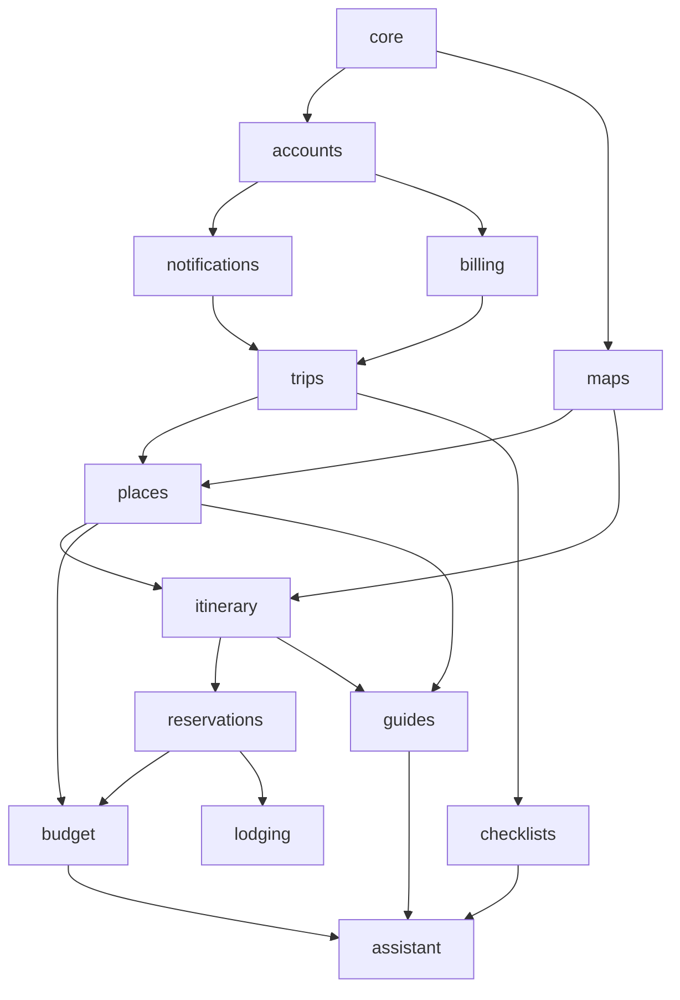

# Piano di implementazione — WANDERLOG (Django)

**Versione:** 2.0 (revisione del `plan.md` generato da GitHub Copilot)
**Base:** [specifiche funzionali v1.1](specifiche-funzionali.md) (7 ottobre 2026)
**Destinatario:** team di 5 persone e GitHub Copilot in modalità Agent
**Data:** 29 ottobre 2026

Convenzioni del documento:

- Gli ID tra parentesi (ACC-01, TRP-05, …) e i riferimenti `§n` rimandano alle specifiche. Non ci sono requisiti inventati.
- Le scelte tecniche che non vengono dalle specifiche sono marcate **Decisione proposta**. Si possono cambiare, ma vanno cambiate qui prima di scrivere codice.
- Le scelte che bloccano una fase sono marcate **Decisione aperta Dn** (elenco completo al §4).
- I percorsi sono relativi alla **radice del repository** `WANDERLOG/` (la cartella che contiene `compose.yaml`).
- I comandi di checkpoint si eseguono dalla radice del repository. Su Windows PowerShell usare `curl.exe` al posto di `curl`.

---

## 0. Istruzioni per GitHub Copilot (modalità Agent)

1. Esegui **un task alla volta**, nell'ordine delle fasi. Non iniziare un task se il checkpoint della fase precedente non passa.
2. Prima di chiudere un task esegui i comandi del suo checkpoint e riporta l'output. Un task è finito solo se **tutti** i comandi escono con codice 0 e i criteri sono veri.
3. Non rigenerare il progetto: **non** eseguire `django-admin startproject` né `startapp` per le app già esistenti (§1).
4. Ogni modello nuovo nasce nell'app indicata al §5. Ogni modifica di modello è accompagnata dalla sua migrazione (`makemigrations <app>`), e `makemigrations --check --dry-run` deve risultare pulito.
5. Rispetta il grafo delle dipendenze (§6): un'app non importa mai un'app che sta sopra di lei. Il controllo è automatico (`lint-imports`).
6. Ogni endpoint nuovo ha test di permesso secondo la matrice del §7.
7. Ogni stringa visibile all'utente è marcata per la traduzione (`gettext` / `t()`), con testo in italiano e in inglese.
8. Non scrivere segreti nel codice e non fare commit di `.env`. Le chiavi esterne si leggono da variabili d'ambiente (§10). Senza chiave si usa il provider `mock`.
9. Se un task richiede una decisione aperta non ancora presa (§4), fermati e segnalalo. Non scegliere al posto del team.

---

## 1. Stato reale del repository (punto di partenza)

```
WANDERLOG/                      # radice git
├── compose.yaml                # django, db (postgres:17), redis, mailpit (axllent/mailpit)
├── Dockerfile                  # python:3.12-slim, WORKDIR /app/WANDERLOG, runserver
├── requirements.txt            # Django>=5.2,<5.3, psycopg[binary], dj-database-url, redis, celery
├── .dockerignore
├── docs/
│   └── specifiche-funzionali.md
└── WANDERLOG/                  # progetto Django (contiene manage.py)
    ├── manage.py
    ├── WANDERLOG/              # package di configurazione
    │   ├── settings.py         # DATABASES via dj_database_url.config(...)
    │   ├── urls.py, asgi.py, wsgi.py
    ├── accounts/  assistant/  billing/  budget/  checklists/  core/  guides/
    └── itinerary/ lodging/  maps/  notifications/  places/  reservations/  trips/
```

Cosa manca oggi e va sistemato nella Fase 0:

- Le 14 app esistono (`models.py` vuoti, cartelle `migrations/` vuote) ma **non sono in `INSTALLED_APPS`**.
- **Non esiste un custom user model.** Va creato **prima del primo `migrate`** delle app.
- `settings.py` ha `SECRET_KEY` e `DEBUG = True` scritti nel codice e `ALLOWED_HOSTS = []`. La variabile `DEBUG` passata dal compose viene ignorata. `LANGUAGE_CODE = "en-us"`.
- Il compose non ha un worker Celery, né beat, né il server Vite. Non c'è `.env.example`.
- Le dipendenze per API, realtime, login Google, immagini e test sono assenti.

**Decisione aperta D3 (raccomandazione: confermare).** Le app restano **nella radice del progetto Django** (`WANDERLOG/<app>/`), come sono oggi. Il piano di Copilot proponeva `apps/` + `config/settings/` divisi: questo piano **non** li adotta. Spostarle costerebbe un refactoring senza benefici funzionali, mentre `settings.py` unico, letto da variabili d'ambiente, basta. Se il team vuole comunque `apps/`, lo spostamento va fatto nel task 0.1, prima di qualsiasi migrazione.

**Decisione proposta.** Non creare un'app `web` (presente nel piano di Copilot, non nelle specifiche §10): le pagine pubbliche generiche (home, pagine legali) vanno in `core`, quelle di destinazioni e guide in `guides`.

---

## 2. Approccio generale (confermato dal piano originale, con correzioni)

- **Monolite Django modulare.** Un'API REST unica per web e futura app (§4.2): `/api/v1/` con Django REST Framework e drf-spectacular (OpenAPI). *Decisione proposta.*
- **Frontend.** Pagine pubbliche (home, destinazioni, guide, luoghi, autenticazione, pagine legali) con **template Django**, per la SEO. Per l'editor del viaggio vedi la **Decisione aperta D2**:
  - **opzione A (default di questo piano, come nel piano originale):** SPA React + Vite + TypeScript servita da Django (con `django-vite`), che consuma l'API;
  - **opzione B:** template Django + HTMX + JavaScript leggero per mappa e trascinamento.
  I task marcati **[SPA]** si applicano solo con l'opzione A.
- **Adapter mappe** in `maps/`: interfacce `PlaceProvider`, `RouteProvider`, `Geocoder` e un `MockProvider` per sviluppo e test. **Attenzione:** a differenza del piano originale, il provider reale va scelto **prima dello schema di `places`** (Decisione aperta D1), perché la licenza limita cosa si può salvare (§11, §13).
- **Tempo reale (COL-02, §10):** Django Channels + `channels-redis`, un gruppo per viaggio. Il server è ASGI tramite `daphne`.
- **Task asincroni:** Celery con broker Redis (worker + beat), per parser email, notifiche, cambi valuta e, in Fase 2, stato voli e cali di prezzo.
- **i18n:** italiano e inglese dalla Fase 0 (§4.1 punto 6, §12).
- **Ambiente di sviluppo:** Docker Compose (già presente, da estendere al §9).

---

## 3. Workstream del team (5 persone, ribilanciati)

Rispetto al piano originale, `notifications` passa da B ad A e `checklists` da D a E, per alleggerire B (realtime) e D.

| Dev | Workstream | App di proprietà | Requisiti principali |
| --- | --- | --- | --- |
| **A** | Piattaforma, account, notifiche, abbonamento | `core`, `accounts`, `notifications`, `billing` | Fase 0, ACC-01..07, OFF-03, SUB-01..03, CI, sicurezza |
| **B** | Viaggi e collaborazione | `trips` (+ realtime, attività, inviti, commenti) | TRP-01..14, COL-01..06 |
| **C** | Luoghi, mappa, itinerario | `maps`, `places`, `itinerary` | PLC-01..09, MAP-01..07, ITN-01..10 |
| **D** | Prenotazioni e budget | `reservations`, `budget` | RES-01..10, BDG-01..08 |
| **E** | Scoperta, checklist, alloggi, assistente | `guides`, `checklists`, `lodging`, `assistant` | GDE-01..09, CHK-01..04, HOT-01..07, AI-01..06 |

Ogni dev possiede modelli, serializer, view, URL, test e la propria parte dell'editor ([SPA] `frontend/editor/src/features/<area>/`). Le revisioni incrociate sono obbligatorie su `core/`, `trips/` (dominio condiviso) e `frontend/packages/shared/`.

---

## 4. Decisioni aperte

| ID | Decisione | Fonte | Blocca | Raccomandazione |
| --- | --- | --- | --- | --- |
| **D1** | **Provider mappe e luoghi** (costi, cache consentita, qualità in Italia, embed, export verso Google Maps) | §11, §13, §18.2 | **Task 1A.3 (schema `places`)**. La Fase 0 e `maps` con mock possono partire | Decidere entro la fine della Fase 0. Documentare in `docs/adr/0001-provider-mappe.md` quali campi si possono salvare e per quanto tempo |
| **D2** | **Editor SPA React o template Django + HTMX** | non nelle specifiche (il piano originale dice SPA) | Task 0.8 | SPA React (opzione A), se il team conosce React. Altrimenti B |
| **D3** | **App nella radice del progetto Django o in `apps/`** | stato del repo | Task 0.1 | **Radice (consigliato)** |
| D4 | Nome del prodotto e dominio | §18.1 | Indirizzo `trip+…@dominio` in produzione (RES-03), pagine legali | In sviluppo si usa `wanderlog.local` |
| D5 | Flutter o React Native per l'app | §18.3 | Fase 2 (app) | Fuori dal perimetro di questo piano |
| D6 | Guide della community visibili subito o dopo moderazione | §18.4, GDE-05 | Fase 2 | — |
| D7 | Listino Pro (riferimento: 39,99 USD/anno, prova di 7 giorni; mensile come estensione) | §18.5, SUB-01, NEW-09 | Fase 2 | — |
| D8 | Affiliati alloggi da attivare al lancio | §18.6, HOT-06 | Fase 2 | — |
| D9 | Servizio di email in entrata in produzione (webhook) | §11 "Email in entrata" | Rilascio della Fase 1 | *Decisione proposta:* un provider con webhook firmato |
| D10 | Provider di meteo, stato voli, tassi di cambio, LLM, push | §11 | Cambi: Fase 1 (BDG-06). Gli altri: Fase 2/3 | Ogni provider sta dietro un adapter con mock |
| D11 | Storage dei file in produzione | §12 (file privati) | Fase 2 (RES-06) | *Decisione proposta:* S3-compatibile con URL firmati |
| D12 | Autenticazione dell'app mobile (token DRF o JWT) | §4.2 | Fase 2 | *Decisione proposta:* JWT (`djangorestframework-simplejwt`) |
| D13 | Significato di "racconti" (§10 `guides`, §14 Fase 3) rispetto al diario (GDE-08) | §10, §14 | Fase 3 | Chiarire con chi ha scritto le specifiche |

---

## 5. Modello dati

I nomi sono quelli delle entità del §6 tradotti in modelli. Tutti ereditano da `core.BaseModel`: chiave primaria UUID (non indovinabile, §12), `created_at`, `updated_at`. Le FK tra app usano riferimenti stringa (`"trips.Trip"`).

| Entità §6 | Modello | App | Campi principali | FK / relazioni principali | Fase |
| --- | --- | --- | --- | --- | --- |
| Utente | `User(AbstractUser)` | `accounts` | email (unica, `USERNAME_FIELD`), name, photo, language (`it`/`en`), distance_unit (`km`/`mi`), default_currency, timezone, plan (`free`/`pro`, aggiornato da `billing`) | — | **0** |
| (TRP-05 "follower") | `Follow` | `accounts` | follower, followed | FK `User` ×2, unica | 1 (minimo, senza feed: §16) |
| Utente: caselle collegate | `ConnectedMailbox`, `MailboxReadLog` | `accounts` | provider, token cifrato, scope, revoked_at; log dei messaggi letti | FK `User` | 2 (ACC-06, RES-05) |
| Viaggio | `Trip` | `trips` | title, cover, cover_source (`auto`/`custom`), start_date?, end_date?, timezone, visibility (`private`/`link`/`followers`/`public`), currency, budget_total?, archived, default_transport (Fase 2, TRP-13), inbound_token (casuale, per `trip+<token>@`), link_token | FK `owner → User` | 1A |
| Destinazione del viaggio | `TripDestination` | `trips` | name, provider_ref, lat, lng, order | FK `Trip` | 1A |
| Giorno | `Day` | `trips` | date?, title?, note, order, color | FK `Trip` | 1A |
| Sezione | `Section` | `trips` | type (`places_list`/`note`/`checklist`/`itinerary`/`reservations`/`budget`), title, color, icon, order, visible, is_system, body (per `note`) | FK `Trip` | 1A |
| Collaboratore | `Membership` | `trips` | role (`owner`/`editor`/`viewer`) | FK `Trip`, FK `User`, unica | 1A |
| Invito | `Invite` | `trips` | email?, token_hash, role (`editor`/`viewer`), status, expires_at | FK `Trip`, FK `invited_by → User` | 1A |
| (COL-04) Registro attività | `ActivityEntry` | `trips` | verb, target_type, target_id, before (JSON), after (JSON) | FK `Trip`, FK `actor → User` | 1A |
| (COL-03) Revisione nota | `NoteRevision` | `trips` | target_type, target_id, body, superseded | FK `Trip`, FK `author → User` | 1A |
| (COL-05) Commento | `Comment` | `trips` | target_type, target_id, body | FK `Trip`, FK `User` | 2 |
| Luogo | `Place` | `places` | provider, external_id, name, lat, lng, address, categories, short_description, photos, website, phone, opening_hours, rating, reviews_count, source, fetched_at, is_custom (PLC-08). **Quali campi si salvano dipende da D1** | univoco (provider, external_id) | 1A |
| Voce luogo | `PlaceItem` | `places` | note, custom_photo, start_time?, end_time?, cost?, status (`idea`/`planned`/`done`) | FK `Trip`, FK `Place` | 1A |
| Voce in lista | `ListEntry` | `places` | order | FK `Section(type=places_list)`, FK `PlaceItem` (una voce può stare in più liste, PLC-06) | 1A |
| Tappa/elemento del giorno | `DayEntry` *(Decisione proposta)* | `itinerary` | kind (`place`/`note`/`checklist`), order, start_time?, end_time?, note | FK `Day`, FK `PlaceItem?` (al massimo un giorno per voce) | 1A |
| Tratta | `Leg` | `itinerary` | mode (`car`/`walk`/`transit`/`bike`/`taxi`/`flight`/`train`/`ferry`), duration_s?, distance_m?, geometry?, estimate_available, provider | FK `from_entry → DayEntry`, FK `to_entry → DayEntry` | 1A |
| Prenotazione | `Reservation` | `reservations` | type (vedi nota), status, start_at, end_at, confirmation_code, supplier, price?, currency, source_email?, details (JSON per campi specifici: numero volo, aeroporti, scali, gate; check-in e check-out; ritiro e riconsegna; dal NEW-04: carrozza, posto, stazione), included_in_package (RES-10) | FK `Trip`, FK `Day?`, FK `Place?` | 1B |
| (RES-03/04) Email in entrata | `InboundEmail` | `reservations` | raw (privato), from, subject, status (`received`/`parsed`/`unrecognized`/`error`), parser | FK `Trip`, FK `Reservation?` | 1B |
| Allegato | `Attachment` | `reservations` | file o url, name, mime_type, size | FK `Trip`, FK `Reservation?`, FK `uploaded_by → User` | 1B (email non riconosciute, RES-04). Upload libero in 2 (RES-06) |
| Spesa | `Expense` | `budget` | amount, currency, fx_rate, amount_trip_currency, fx_rate_overridden, date?, category, split_mode (`none`/`equal`/`shares`/`fixed`), excluded_from_budget | FK `Trip`, FK `payer → User`, FK `PlaceItem?`, FK `Reservation?` | 1B |
| Partecipante alla spesa | `ExpenseShare` | `budget` | share?, amount? | FK `Expense`, FK `User` | 1B |
| (BDG-06) Tasso di cambio | `ExchangeRate` | `budget` | date, base, quote, rate, source | univoco (date, base, quote) | 1B |
| Voce checklist | `ChecklistItem` | `checklists` | text, checked, quantity?, order | FK `Section(type=checklist)?` oppure FK `Day?`, FK `assignee → User?` (CHK-03) | 1B |
| (CHK-02) Modello di checklist | `ChecklistTemplate`, `ChecklistTemplateItem` | `checklists` | trip_kind (`city`/`sea`/`mountain`/`child`), language | — | 1B |
| (GDE-01) Destinazione editoriale | `Destination` | `guides` | name, slug, description, lat, lng, language | — | 1B |
| Guida | `Guide`, `GuideDay`, `GuidePlace` | `guides` | title, body, cover, status (`draft`/`review`/`published`), language, saves_count, kind (`guide`/`itinerary`/`road_trip`) | FK `author → User`, FK `Destination`, FK `Place` (in `GuidePlace`) | 1B |
| (GDE-06) Domanda/risposta | `Question`, `Answer` | `guides` | body, status di moderazione | FK `Destination`, FK `User` | 2 |
| (TRP-11 / GDE-08) Diario | `Journal`, `JournalStop` | `guides` | summary, cover, visibility (indipendente dal piano); fermate con foto, note, ordine | OneToOne `Trip`; FK `Place?` | 1B (base) / 2 (completo) |
| Abbonamento | `Subscription` | `billing` | provider (`stripe`/`app_store`/`play`), plan, status, renews_at, current_period_end, trial_end, cancel_at_period_end | FK `User` | 2 |
| Notifiche | `Notification`, `PushDevice` | `notifications` | kind, payload, read_at; token del dispositivo | FK `User` | 1B (email di invito) / 2 (push) |
| Alloggi | `SavedLodging`, `PriceWatch`, `OutboundClick` | `lodging` | candidato o prenotazione, soglia, clic tracciato | FK `Trip`, FK `User`, FK `Reservation?` | 2 |
| Assistente | `Conversation`, `Message`, `AssistantUsage` | `assistant` | messaggi, allegato, contatore della quota | FK `Trip`, FK `User` | 2 |

Note sul modello:

- **Tipi di prenotazione.** Le specifiche hanno due elenchi diversi: RES-01 (volo, alloggio, auto, ristorante, treno, autobus, traghetto, crociera, allegato) e §6 (volo, alloggio, auto, treno, bus, traghetto, evento, altro). *Decisione proposta:* l'enum è l'unione dei due (`flight`, `lodging`, `car`, `restaurant`, `train`, `bus`, `ferry`, `cruise`, `event`, `other`). "Allegato" diventa un `Attachment` senza prenotazione.
- **Mezzi di trasporto.** L'enum di `Leg` contiene già tutti i mezzi del §6. In Fase 1 l'interfaccia abilita auto, a piedi, trasporto pubblico e bici (ITN-04). Gli altri mezzi si abilitano in Fase 3 (ITN-10).
- **Copertura del provider (§11).** Se il provider non fornisce una stima, `Leg.estimate_available = False` e l'interfaccia lo dice, senza inventare un tempo.
- **Sezioni di sistema.** Creando un viaggio si creano le sezioni `itinerary`, `reservations` e `budget` con `is_system=True`, che non si cancellano (§6), e una lista "Senza titolo".
- **Budget e valuta di riferimento** sono campi di `Trip` (§6).

---

## 6. Grafo delle dipendenze tra app

Freccia `A --> B`: **B dipende da A**, quindi A si costruisce prima e B può importare A, mai il contrario.



Livelli (dall'alto in basso; un livello può importare solo quelli sotto): `assistant` → `lodging` → `guides` → `checklists` → `budget` → `reservations` → `itinerary` → `places` → `trips` → `maps` → `billing` → `notifications` → `accounts` → `core`.

Regole (sostituiscono la regola "nessuna app importa modelli di un'altra" del piano originale, che in Django non si può applicare):

- Le **FK verso app di livello inferiore sono permesse.**
- Le **scritture** su modelli di un'altra app passano solo dal suo `services.py`, per esempio `trips.services.record_activity()`.
- **Flusso inverso:** quando un'app bassa deve reagire a un evento di un'app alta, si usano segnali definiti nell'app bassa. Esempi:
  - ACC-04: `accounts` emette `user_deleting`, `trips` gestisce il trasferimento o l'eliminazione dei viaggi;
  - BDG-07: `reservations` emette `reservation_priced`, `budget` crea la spesa proposta;
  - TRP-14: la conversione del viaggio in guida sta in `guides`.
- **Controllo automatico** *(Decisione proposta)*: `import-linter` con un contratto `layers` in `WANDERLOG/.importlinter`, eseguito in CI.

---

## 7. Matrice dei permessi

Ruoli: **Vis** = visitatore anonimo, **Reg** = utente registrato non membro, **Link** = chi ha il link (visibilità `link`), **Fol** = follower del proprietario (visibilità `followers`), **Let** = compagno in sola lettura, **Mod** = compagno con modifica, **Prop** = proprietario, **Staff** = staff editoriale, **Adm** = amministratore.

| Azione | Vis | Reg | Link | Fol | Let | Mod | Prop | Staff | Adm |
| --- | --- | --- | --- | --- | --- | --- | --- | --- | --- |
| Leggere un viaggio `public` (piano e luoghi) | ✓ | ✓ | ✓ | ✓ | ✓ | ✓ | ✓ | ✓ | ✓ |
| Leggere un viaggio `followers` | — | — | — | ✓ | ✓ | ✓ | ✓ | — | ✓¹ |
| Leggere un viaggio `link` | — | — | ✓ | — | ✓ | ✓ | ✓ | — | ✓¹ |
| Leggere un viaggio `private` | — | — | — | — | ✓ | ✓ | ✓ | — | ✓¹ |
| Leggere prenotazioni, email importate, allegati, spese e indirizzo `trip+` | — | — | — | — | ✓ | ✓ | ✓ | — | ✓¹ |
| Modificare contenuti (luoghi, giorni, note, liste, checklist, prenotazioni, spese) | — | — | — | — | — | ✓ | ✓ | — | — |
| Duplicare il viaggio nel proprio account *(Decisione proposta)* | — | ✓² | ✓² | ✓² | ✓ | ✓ | ✓ | — | — |
| Archiviare il viaggio *(Decisione proposta: per il proprio elenco)* | — | — | — | — | — | — | ✓ | — | — |
| Cambiare la visibilità | — | — | — | — | — | — | ✓ | — | — |
| Invitare, revocare, cambiare ruolo (COL-01) | — | — | — | — | — | — | ✓ | — | — |
| Eliminare il viaggio (TRP-04) | — | — | — | — | — | — | ✓ | — | ✓¹ |
| Abbandonare un viaggio condiviso | — | — | — | — | ✓ | ✓ | — | — | — |
| Commentare una voce (COL-05, Fase 2) | — | — | — | — | ✓³ | ✓ | ✓ | — | — |
| Pubblicare una guida (GDE-05) | — | ✓ | — | — | — | — | — | ✓ | ✓ |
| Approvare guide, curare destinazioni e luoghi in evidenza | — | — | — | — | — | — | — | ✓ | ✓ |
| Moderare Q&A e segnalazioni (GDE-05/06) | — | — | — | — | — | — | — | ✓ | ✓ |
| Gestire utenti e piani | — | — | — | — | — | — | — | — | ✓ |

¹ Solo dal Django admin, per moderazione e supporto, con traccia nell'admin log. ² Solo se il viaggio è leggibile da quel ruolo. ³ Se il team decide che chi legge può anche commentare; altrimenti solo Mod e Prop.

Regole di applicazione:

- **Prenotazioni, email e spese.** Restano visibili solo ai collaboratori anche quando il viaggio è pubblico. È l'interpretazione di §12 ("email di conferma … visibili solo ai collaboratori").
- **Un solo punto di controllo:** la policy sta in `trips/policies.py` (`can_read`, `can_edit`, `can_manage`) e la usano, nello stesso modo, i permission class DRF, le view template, il consumer WebSocket (alla connessione e a ogni messaggio) e il download dei file (§10, "file e prenotazioni seguono il permesso del viaggio").
- **Limiti Pro** (SUB-03): `billing.services.has_feature(user, feature)` controlla lato server, mai solo nell'interfaccia.
- **Test:** `trips/tests/test_permissions.py` è parametrizzato su questa matrice, con una riga per cella.

---

## 8. Requirements

`requirements.txt` (runtime). Le righe vanno aggiunte **nella fase indicata**, non tutte subito.

```text
# esistenti
Django>=5.2,<5.3
psycopg[binary]>=3.2
dj-database-url>=2.2
redis>=5.0
celery>=5.4
# Fase 0
djangorestframework>=3.15
drf-spectacular>=0.27
channels>=4.1
channels-redis>=4.2
daphne>=4.1
django-allauth[socialaccount]>=65.0     # ACC-01 Google, ACC-02 recupero password — Decisione proposta
Pillow>=10.4                            # foto profilo e copertine (ACC-03, TRP-06)
httpx>=0.27                             # client HTTP per gli adapter esterni
django-vite>=3.0                        # [SPA] solo con D2 = opzione A
# Fase 2
django-storages[s3]>=1.14               # D11
stripe>=10.0                            # SUB-01/02
cryptography>=43                        # cifratura dei token Gmail (ACC-06)
djangorestframework-simplejwt>=5.3      # D12
```

`requirements-dev.txt` (nuovo, *Decisione proposta*):

```text
-r requirements.txt
pytest>=8
pytest-django>=4.9
pytest-cov>=5
factory-boy>=3.3
ruff>=0.6                # lint e formattazione: sostituisce "flake8 o black" del piano originale
import-linter>=2.0
pytest-playwright>=0.5   # e2e (§11 di questo piano)
```

Il `Dockerfile` installa `requirements-dev.txt` quando è impostato `ARG DEV=1`, che il compose di sviluppo imposta.

---

## 9. Compose (sviluppo)

Le modifiche a `compose.yaml` mantengono i servizi esistenti (`postgres:17`, `axllent/mailpit`, i nomi `db`, `redis`, `mailpit`) e spostano le variabili in `.env`.

```yaml
x-django: &django
  build:
    context: .
    args: { DEV: "1" }
  volumes:
    - .:/app
  working_dir: /app/WANDERLOG
  env_file: .env
  depends_on:
    db: { condition: service_healthy }
    redis: { condition: service_started }
    mailpit: { condition: service_started }

services:
  django:
    <<: *django
    # con "daphne" in testa a INSTALLED_APPS, runserver serve ASGI (HTTP + WebSocket)
    command: python manage.py runserver 0.0.0.0:8000
    ports: ["8000:8000"]

  celery-worker:
    <<: *django
    command: celery -A WANDERLOG worker -l info

  celery-beat:
    <<: *django
    command: celery -A WANDERLOG beat -l info --schedule /tmp/celerybeat-schedule

  db:
    image: postgres:17
    environment:
      POSTGRES_DB: wanderlog
      POSTGRES_USER: user
      POSTGRES_PASSWORD: password
    volumes:
      - postgres_data:/var/lib/postgresql/data
    healthcheck:
      test: ["CMD-SHELL", "pg_isready -U user -d wanderlog"]
      interval: 5s
      retries: 10

  redis:
    image: redis:7            # Decisione proposta: versione fissata al posto di latest

  mailpit:
    image: axllent/mailpit
    ports: ["1025:1025", "8025:8025"]

  vite:                       # [SPA] solo con D2 = opzione A
    image: node:22-alpine
    working_dir: /app/frontend
    volumes: [".:/app"]
    command: sh -c "npm ci && npm run dev -- --host 0.0.0.0"
    ports: ["5173:5173"]

  e2e:                        # avviato solo con --profile e2e
    profiles: ["e2e"]
    image: mcr.microsoft.com/playwright/python:v1.48.0-jammy
    working_dir: /app
    volumes: [".:/app"]
    env_file: .env
    environment:
      E2E_BASE_URL: http://django:8000
    command: sh -c "pip install -r requirements-dev.txt && pytest e2e"
    depends_on: [django, celery-worker]

volumes:
  postgres_data:
```

Produzione (fuori dal compose di sviluppo, *Decisione proposta*): `daphne -b 0.0.0.0 -p 8000 WANDERLOG.asgi:application` (oppure uvicorn), `DEBUG=False`, statici serviti con un build Vite.

**Email in entrata in sviluppo** *(Decisione proposta)*. Mailpit raccoglie la posta SMTP, ma non la inoltra a Django. Due strade, da tenere entrambe:

1. un comando `python manage.py ingest_eml <file.eml>` per i test e le fixture;
2. un task beat `reservations.tasks.poll_mailpit`, solo con `DEBUG`, che legge `MAILPIT_API_URL` (`/api/v1/messages` e il raw del messaggio), prende le email indirizzate a `trip+*@${INBOUND_EMAIL_DOMAIN}` e le passa allo stesso parser.

In produzione c'è un webhook firmato del provider (D9), sempre verso lo stesso parser.

---

## 10. `.env.example` (nuovo file nella radice)

```dotenv
# --- Django ---
DJANGO_SECRET_KEY=change-me
DEBUG=True
ALLOWED_HOSTS=localhost,127.0.0.1,django
CSRF_TRUSTED_ORIGINS=http://localhost:8000,http://localhost:5173
SITE_URL=http://localhost:8000

# --- Database / Redis (valori di sviluppo come nel compose attuale) ---
DATABASE_URL=postgres://user:password@db:5432/wanderlog
REDIS_URL=redis://redis:6379/0
CELERY_BROKER_URL=redis://redis:6379/0
CHANNEL_LAYER_URL=redis://redis:6379/1

# --- Email in uscita (Mailpit in dev) ---
EMAIL_HOST=mailpit
EMAIL_PORT=1025
DEFAULT_FROM_EMAIL=noreply@wanderlog.local

# --- Email in entrata (RES-03/04) ---
INBOUND_EMAIL_DOMAIN=wanderlog.local          # D4
INBOUND_EMAIL_WEBHOOK_SECRET=                 # D9, produzione
MAILPIT_API_URL=http://mailpit:8025

# --- Login Google (ACC-01) ---
GOOGLE_OAUTH_CLIENT_ID=
GOOGLE_OAUTH_CLIENT_SECRET=

# --- Mappe e luoghi (D1) ---
MAPS_PROVIDER=mock                            # mock | <provider scelto in D1>
MAPS_SERVER_API_KEY=
MAPS_BROWSER_API_KEY=                         # chiave pubblica limitata per dominio

# --- Tassi di cambio (BDG-06, Fase 1) ---
FX_PROVIDER=mock
FX_API_KEY=

# --- Fase 2 / 3 ---
GMAIL_OAUTH_CLIENT_ID=
GMAIL_OAUTH_CLIENT_SECRET=
FIELD_ENCRYPTION_KEY=                         # cifratura dei token delle caselle
FLIGHT_STATUS_PROVIDER=mock
FLIGHT_STATUS_API_KEY=
WEATHER_PROVIDER=mock
WEATHER_API_KEY=
LLM_PROVIDER=mock
LLM_API_KEY=
LLM_MODEL=
AI_FREE_MESSAGE_QUOTA=10                      # AI-05
STRIPE_SECRET_KEY=
STRIPE_PUBLISHABLE_KEY=
STRIPE_WEBHOOK_SECRET=
STRIPE_PRICE_PRO_YEARLY=
STRIPE_PRICE_PRO_MONTHLY=                     # NEW-09, Fase 3
PUSH_FCM_CREDENTIALS_JSON=
PUSH_APNS_KEY_ID=
PUSH_APNS_TEAM_ID=
PUSH_APNS_PRIVATE_KEY=
LODGING_AFFILIATE_KEYS=                       # D8
STORAGE_BACKEND=filesystem                    # filesystem | s3 (D11)
AWS_ACCESS_KEY_ID=
AWS_SECRET_ACCESS_KEY=
AWS_STORAGE_BUCKET_NAME=
AWS_S3_ENDPOINT_URL=
FREE_ATTACHMENT_QUOTA_MB=                     # RES-06, valore da decidere
MAX_UPLOAD_MB=20                              # §12, limite di upload
```

Ogni adapter esterno (`maps`, cambi, voli, meteo, LLM, push, pagamenti) ha un'implementazione `mock` deterministica, usata quando la chiave è vuota e sempre nei test.

---

## 11. Strategia di test

| Livello | Strumento | Dove | Quando |
| --- | --- | --- | --- |
| Unità e modelli | pytest + pytest-django + factory_boy | `WANDERLOG/<app>/tests/` | Ogni PR |
| API e permessi | DRF `APIClient`, test parametrizzati sulla matrice §7 | `trips/tests/test_permissions.py` e `tests/` di ogni app | Ogni PR |
| WebSocket | `channels.testing.WebsocketCommunicator` | `trips/tests/test_realtime.py` | Ogni PR |
| Task Celery | `CELERY_TASK_ALWAYS_EAGER=True` nei test | test di ogni app | Ogni PR |
| Parser email | fixture `.eml` di esempio, scritte dal team (niente email reali) | `reservations/tests/fixtures/emails/` | Ogni PR |
| Contratto API | schema OpenAPI generato e confrontato con quello del repo; [SPA] client TS rigenerato senza differenze | CI | Ogni PR |
| E2E | Playwright (pytest-playwright), servizio `e2e` del compose | `e2e/` nella radice | PR verso `main` e ogni notte |
| Accessibilità | axe-core iniettato nei test Playwright *(Decisione proposta)* | `e2e/test_a11y.py` | PR verso `main` |
| Prestazioni | viaggio di prova con 200 luoghi: risposta dell'API e apertura dell'editor sotto i 3 s (§12) | `e2e/test_performance.py` | Ogni notte |

Configurazione: `WANDERLOG/pytest.ini` (accanto a `manage.py`) con `DJANGO_SETTINGS_MODULE = WANDERLOG.settings`. Copertura minima *(Decisione proposta)*: 80% su `trips`, `places`, `itinerary`, `reservations`, `budget`.

**Test di accettazione obbligatori** (un file per criterio):

| File | Criterio |
| --- | --- |
| `e2e/test_acc15_01_viaggio_5_giorni.py` | §15.1 e criterio TRP-01 ("Roma", 12–16 giugno → 5 giorni vuoti e Roma sulla mappa) |
| `e2e/test_acc15_02_dieci_luoghi.py` | §15.2: 10 luoghi, da ricerca e da una guida (criterio GDE-03: luogo aggiunto al giorno 2 e visibile sulla mappa) |
| `e2e/test_acc15_03_orari_distanze.py` | §15.3: distribuzione sui giorni, orari, tempi e distanze (ITN-01..03) |
| `e2e/test_acc15_04_mappa_filtrata.py` | §15.4: pin filtrati per giorno (MAP-03) |
| `e2e/test_acc15_05_compagno_live.py` | §15.5: due browser; il secondo, con ruolo modifica, vede l'aggiornamento entro 5 s (§12 Sync) |
| `e2e/test_acc15_06_volo_manuale_email.py` | §15.6 e criterio RES-03: volo inserito a mano più volo da email di prova, visibile nel giorno corretto entro 60 s |
| `e2e/test_acc15_07_budget_bivaluta.py` | §15.7: spese in EUR e in un'altra valuta, totale convertito e saldo tra i due |
| `e2e/test_acc15_08_checklist.py` | §15.8: spunta di una checklist di bagaglio |
| `e2e/test_acc15_09_altro_browser.py` | §15.9: nuovo contesto browser con lo stesso account, dati integri |
| `e2e/test_itn07_ottimizzazione.py` | Criterio ITN-07 (Fase 2) |

---

## 12. Sicurezza e privacy (§12, §13)

| Tema | Misura | Fase |
| --- | --- | --- |
| Segreti | `SECRET_KEY`, `DEBUG`, `ALLOWED_HOSTS` letti da variabili d'ambiente (oggi sono nel codice). `DEBUG=False` di default fuori dallo sviluppo | 0 |
| Password | Hasher Django di default (PBKDF2), *Decisione proposta:* Argon2 con `argon2-cffi`. Validatori già presenti | 0 |
| Sessioni revocabili | Sessioni lato server. "Esci da tutti i dispositivi" nel profilo. [SPA] stessa origine con cookie di sessione e CSRF, niente token in `localStorage` | 1 |
| Inviti | Token casuale, salvato solo come hash, con scadenza (*Decisione proposta:* 14 giorni), monouso per gli inviti via email, revocabile | 1A |
| Indirizzo `trip+` | Token casuale non sequenziale e rigenerabile, non l'ID del viaggio | 1B |
| File | Nomi casuali (UUID), download solo da una view che applica la policy, URL firmati con scadenza su S3 (D11), limite `MAX_UPLOAD_MB`, controllo del tipo MIME | 1B / 2 |
| Limitazione delle richieste | *Decisione proposta:* throttling DRF su login, registrazione, recupero password, inviti, assistente | 1 |
| WebSocket | `AllowedHostsOriginValidator`, autenticazione di sessione, policy `can_read`/`can_edit` sul viaggio | 1A |
| CORS | Disattivato in Fase 1 (stessa origine). In Fase 2 lista esplicita per l'app (*Decisione proposta:* `django-cors-headers`) | 2 |
| Gmail (RES-05, ACC-06) | Opt-in, scope minimo, token cifrati (`FIELD_ENCRYPTION_KEY`), revoca immediata, `MailboxReadLog` di ciò che è stato letto (§11) | 2 |
| Pagamenti | Firma dei webhook Stripe verificata, stato dell'abbonamento solo dai webhook, limiti lato server (SUB-03) | 2 |
| LLM | Si invia al modello solo la parte di piano necessaria. L'utente è informato e ogni risposta ha l'avviso di inaccuratezza (§11, AI-05) | 2 |
| Cancellazione dell'account (ACC-04) | Viaggi di cui si è unici proprietari: trasferiti o eliminati. Viaggi condivisi: restano agli altri collaboratori | 1 |
| Export (§12 Disponibilità) | Archivio scaricabile (JSON più allegati) generato da un task Celery e inviato via link firmato | 1 |
| Pagine legali (§9) | Termini, privacy, cookie, in `core`. La privacy policy documenta l'analisi della posta (§13) | 1 |
| Licenze dei contenuti (§13) | Recensioni e foto mostrate solo se la licenza del provider (D1) lo permette, con attribuzione. Nessuno scraping di Wanderlog. Fixture con contenuti originali | 1 |
| Admin | Django admin solo per staff e admin, con 2FA *(Decisione proposta, allauth MFA)* | 1 |

---

## 13. i18n e accessibilità (Fase 1, non rimandabili)

i18n (§4.1 punto 6, §12, NEW-01):

- `LANGUAGE_CODE = "it"`, `LANGUAGES = [("it", "Italiano"), ("en", "English")]`, `LocaleMiddleware`, `LOCALE_PATHS`. Pagine pubbliche con `i18n_patterns` (`/it/…`, `/en/…`). `TIME_ZONE = "UTC"` con fuso dell'utente e del viaggio salvati nei modelli.
- La lingua dell'utente (`User.language`) prevale sull'header del browser. È presente un selettore di lingua (home autenticata, §3).
- Formati di data, numero e valuta localizzati. Distanze in km o miglia secondo `User.distance_unit` (ACC-03, NEW-01).
- Contenuti editoriali: `Guide.language` e `Destination.language`; il contenuto indica la propria lingua (§12).
- [SPA] i18next con `it.json` ed `en.json`. CI: `makemessages` senza stringhe nuove non tradotte, `compilemessages`, e un controllo che le chiavi `it` ed `en` coincidano.

Accessibilità (§12, NEW-12):

- Form etichettati, focus visibile, contrasto AA, alternative testuali (`aria-label`) per tutte le azioni a icona dell'editor.
- Riordino accessibile da tastiera: trascinamento con alternativa da tastiera e annunci per i lettori di schermo (*Decisione proposta:* `@dnd-kit` con il sensore tastiera; per l'opzione B pulsanti "su/giù").
- Su mobile l'editor passa a schede (MAP-01, §9).
- Test axe-core senza violazioni "serious" o "critical" sulle pagine dei test §15.

---

## 14. Fasi, task e checkpoint

### Fase 0 — Fondamenta (Dev A guida, tutti contribuiscono)

**0.1 Settings e ambiente**
- Rendere `WANDERLOG/WANDERLOG/settings.py` configurabile da ambiente: `SECRET_KEY`, `DEBUG`, `ALLOWED_HOSTS`, `CSRF_TRUSTED_ORIGINS`, email. Mantenere `dj_database_url.config(...)`.
- Creare `.env.example` (§10). Aggiungere `.env` a `.gitignore` e `.dockerignore`.
- Applicare D3 (raccomandato: nessuno spostamento).
- Checkpoint: `docker compose run --rm django python manage.py check --deploy` mostra solo avvisi attesi in sviluppo. `git grep -n "django-insecure"` non restituisce nulla.

**0.2 Custom user model e registrazione delle app (prima di ogni `migrate`)**
- Se il volume `postgres_data` contiene già tabelle create da un `migrate` precedente, azzerarlo con `docker compose down -v`. **Attenzione: cancella i dati del database di sviluppo.**
- `accounts/models.py`: `User(AbstractUser)` con `username = None`, `email` unica come `USERNAME_FIELD`, manager personalizzato e i campi del §5. In `settings.py`: `AUTH_USER_MODEL = "accounts.User"`.
- Aggiungere a `INSTALLED_APPS`, nell'ordine: `daphne` (in testa), app Django, `rest_framework`, `drf_spectacular`, `channels`, `allauth`, `allauth.account`, `allauth.socialaccount`, `allauth.socialaccount.providers.google`, poi `core`, `accounts`, `notifications`, `billing`, `maps`, `trips`, `places`, `itinerary`, `reservations`, `budget`, `checklists`, `guides`, `lodging`, `assistant` (e `django_vite` con [SPA]).
- `core/models.py`: `BaseModel` astratto (UUID, timestamp).
- Registrare `User` nell'admin.
- Checkpoint:
  ```bash
  docker compose run --rm django python manage.py makemigrations accounts
  docker compose run --rm django python manage.py migrate
  docker compose run --rm django python manage.py makemigrations --check --dry-run
  docker compose run --rm django python -c "import django,os;os.environ.setdefault('DJANGO_SETTINGS_MODULE','WANDERLOG.settings');django.setup();from django.contrib.auth import get_user_model as g;assert g()._meta.label=='accounts.User'"
  ```
  Criterio: `accounts/migrations/0001_initial.py` esiste ed è la prima migrazione applicata insieme a quelle di `auth`.

**0.3 Requirements e compose**
- Aggiornare `requirements.txt` (blocco "Fase 0" del §8), creare `requirements-dev.txt` e aggiornare il `Dockerfile` (`ARG DEV`) e `compose.yaml` (§9).
- `WANDERLOG/WANDERLOG/celery.py` più l'import in `WANDERLOG/WANDERLOG/__init__.py`. Task di prova `core.tasks.ping`.
- Checkpoint:
  ```bash
  docker compose up -d --build
  docker compose ps            # django, celery-worker, celery-beat, db, redis, mailpit in stato running
  docker compose exec django python -c "from core.tasks import ping; print(ping.delay().get(timeout=10))"   # stampa pong
  ```

**0.4 Scheletro dell'API**
- DRF configurato: autenticazione di sessione, paginazione in `core`, permessi di default `IsAuthenticated`, throttling.
- Schema OpenAPI con drf-spectacular su `/api/v1/schema/` e documentazione su `/api/v1/docs/`.
- `core.views.health` su `GET /api/v1/health/` → `{"status":"ok","db":true,"redis":true}`.
- Checkpoint: `curl -fsS http://localhost:8000/api/v1/health/` risponde 200 con `db` e `redis` a `true`. `docker compose exec django python manage.py spectacular --file /tmp/schema.yml --validate` esce con 0.

**0.5 ASGI e Channels**
- `asgi.py` con `ProtocolTypeRouter` (HTTP e WebSocket), `AllowedHostsOriginValidator`, `AuthMiddlewareStack`. `CHANNEL_LAYERS` su `CHANNEL_LAYER_URL`. Consumer di prova `ws/ping/`.
- Checkpoint: test `core/tests/test_ws.py` con `WebsocketCommunicator` verde. Il log di `runserver` riporta l'avvio ASGI/daphne.

**0.6 i18n di base**
- Impostazioni del §13, cartelle `locale/`, `i18n_patterns` per le pagine pubbliche, home `core` minima con selettore di lingua.
- Checkpoint: `curl -fsS http://localhost:8000/it/` e `curl -fsS http://localhost:8000/en/` rispondono 200 con testi diversi. `docker compose exec django python manage.py compilemessages` esce con 0.

**0.7 Qualità e CI**
- `ruff.toml` nella radice, `WANDERLOG/pytest.ini`, `WANDERLOG/.importlinter` (livelli del §6).
- `.github/workflows/ci.yml` con i servizi `postgres:17` e `redis:7`. Passi: `ruff check`, `ruff format --check`, `lint-imports`, `manage.py check`, `makemigrations --check --dry-run`, `compilemessages`, `pytest --cov`, confronto dello schema OpenAPI. [SPA] `npm ci`, `npm run typecheck`, `npm run lint`, `npm run build`.
- Checkpoint: `docker compose exec django sh -c "ruff check .. && lint-imports && pytest -q"` esce con 0. La CI è verde sul branch.

**0.8 Frontend [SPA]** (con D2 = B: template base dell'editor e asset statici)
- `frontend/editor` (Vite + React + TS) e `frontend/packages/shared` (client API generato da OpenAPI, i18next). Integrazione con `django-vite`. Pagina `/trips/<id>/edit` con layout a due colonne (sezioni | mappa) che chiama `/api/v1/health/`.
- Checkpoint: con `docker compose up`, `http://localhost:8000/it/trips/demo/edit` mostra il layout e carica il bundle dal server Vite. `npm run build` esce con 0.

**Checkpoint finale della Fase 0:** `docker compose up -d --build`, tutti i servizi in esecuzione; `curl -fsS http://localhost:8000/api/v1/health/` → 200; CI verde; **D1 e D2 decise** (scritte negli ADR in `docs/adr/`).

---

### Fase 1A — Dominio comune (sequenziale, prima del lavoro in parallelo)

Questa fase evita che `places`, `itinerary`, `reservations`, `budget` e `checklists` partano senza i modelli di `trips`.

**1A.1 `trips` (Dev B):** `Trip`, `TripDestination`, `Day`, `Section`, `Membership`, `Invite`, `ActivityEntry`, `NoteRevision`. Servizi `create_trip` (sezioni di sistema e giorni generati dalle date), `record_activity`. Policy `trips/policies.py` e test della matrice §7.
**1A.2 `maps` (Dev C):** interfacce `PlaceProvider`, `RouteProvider`, `Geocoder`, `MockProvider` deterministico, selezione con `MAPS_PROVIDER`. Generatori di deep link per Google Maps e Apple Maps (ITN-05).
**1A.3 `places` (Dev C), dopo D1:** `Place` (campi salvati secondo la licenza D1, con `fetched_at`), `PlaceItem`, `ListEntry`.
**1A.4 `itinerary` (Dev C):** `DayEntry`, `Leg`. Servizio `recompute_legs(day)` in Celery.
**1A.5 Realtime (Dev B):** consumer `ws/trips/<uuid>/`, gruppo `trip_<uuid>`, broadcast `on_commit` dai servizi.

Checkpoint della Fase 1A:
```bash
docker compose exec django python manage.py makemigrations --check --dry-run
docker compose exec django pytest -q trips places itinerary maps
docker compose exec django lint-imports
```
Criteri: `create_trip(title="Roma", start=12/06, end=16/06)` crea 5 `Day`, le sezioni di sistema e una lista "Senza titolo" (test). La matrice §7 è tutta verde. Un client WebSocket con ruolo `viewer` riceve gli eventi ma ottiene un rifiuto se prova a scrivere.

---

### Fase 1B — Flussi verticali P1 (in parallelo)

Corrisponde a §14 Fase 1 e ai criteri del §15. Ogni dev chiude il proprio blocco con test e checkpoint.

1. **A, account e piattaforma:** ACC-01 (email/password + Google con allauth), ACC-02, ACC-03 (incluse le unità km/miglia, NEW-01), ACC-04 (segnale `user_deleting` gestito da `trips`), ACC-05 (bozza del visitatore in `localStorage`, poi `POST /api/v1/trips/import-draft/` dopo la registrazione). Email di invito (`notifications`). Pagine legali. Export JSON + allegati. Throttling. Admin per staff.
2. **B, viaggi e collaborazione:** TRP-01..06, TRP-09 (anticipato dalla Fase 2, *Decisione proposta*; = NEW-11, giorno corrente evidenziato), TRP-11 (vista diario di base: fermate fatte, note e percorso sulla mappa; il completo è GDE-08 in Fase 2), TRP-12 (salvataggio automatico; annulla/ripeti come pila di comandi lato client che chiama l'operazione inversa via API, ogni operazione registrata in `ActivityEntry`; *Decisione proposta*, al posto dell'undo lato server del piano originale), COL-01..04 (COL-03: sulla stessa nota vince l'ultimo salvataggio, la versione sovrascritta resta in `NoteRevision` ed è recuperabile dal registro attività).
3. **C, luoghi, mappa, itinerario:** PLC-01..06, ITN-01..06 (ITN-04 con la **bici**, NEW-03; tratte senza stima segnalate, §11), MAP-01..04 (vista affiancata su desktop, schede su mobile).
4. **D, prenotazioni e budget:** RES-01, RES-02, RES-09; RES-03/04 (indirizzo `trip+<token>@`, `InboundEmail`, parser per fornitore in Celery, stato delle importazioni, email non riconosciute salvate come `Attachment` con avviso); BDG-01..05; **BDG-06 anticipato** (richiesto da §14 Fase 1 "budget con conversione" e §15.7; = NEW-02): tasso del giorno della spesa, modificabile, totale nella valuta del viaggio con l'importo originale visibile.
5. **E, scoperta e checklist:** GDE-01..04 (guide editoriali in sola lettura scritte dallo staff dall'admin; "Aggiungi al viaggio" su lista o giorno), CHK-01, CHK-02 (modelli città, mare, montagna, bambino, in `it` ed `en`), fixture originali di destinazioni e guide (§13).

Checkpoint di ogni blocco: `docker compose exec django pytest -q <app>` verde; endpoint presenti nello schema OpenAPI; test dei permessi per ogni nuovo endpoint; stringhe tradotte in `it` ed `en`.

### Fase 1C — Integrazione e accettazione del primo rilascio

- Seed: `python manage.py seed_demo` (destinazione, guida con 2 giorni, luoghi mock, modelli di checklist).
- Checkpoint (criterio della fase = §15):
  ```bash
  docker compose exec django python manage.py seed_demo
  docker compose --profile e2e run --rm e2e        # tutti i 9 test e2e/test_acc15_* verdi, più a11y
  docker compose exec django pytest -q              # tutta la suite verde, copertura minima rispettata
  ```
  Più `e2e/test_performance.py`: viaggio con 200 luoghi aperto in meno di 3 s (§12).
- D4 e D9 decise prima del rilascio pubblico.

---

### Fase 2 — Parità da viaggio (P2, §14 Fase 2)

| Blocco | Requisiti | Dev |
| --- | --- | --- |
| Pro e abbonamento | SUB-01, SUB-02, SUB-03 (Stripe, prova di 7 giorni, `has_feature` lato server, D7) | A |
| Caselle collegate | ACC-06, RES-05 (Gmail, opt-in, log delle letture) | A + D |
| Profilo pubblico | ACC-07 | A |
| Notifiche | OFF-03 (invito, commento, stato volo, calo prezzo, promemoria di una tappa con orario), push | A |
| Viaggio | TRP-07, TRP-08 (stampa e PDF), TRP-13 (trasporto predefinito), TRP-14 (converti in guida, in `guides`) | B (+E per TRP-14) |
| Collaborazione | COL-05 (commenti) | B |
| Luoghi | PLC-07 (suggerimenti), PLC-08 (luogo personalizzato) | C |
| Itinerario | ITN-07 (ottimizzazione Pro, **massimo 15 tappe**, inizio e fine fissabili, avviso delle modifiche con **ripristino**; criterio ITN-07), ITN-08 (alloggio come prima e ultima tappa) | C |
| Mappa | MAP-05 (export verso Google Maps, Pro, aggiornato se il piano cambia), MAP-06 (mappa incorporabile in sola lettura per una guida pubblica) | C |
| Prenotazioni | RES-06 (allegati con quota gratuita e quota Pro, D11), RES-07 (spostare una prenotazione tra viaggi), RES-08 (stato volo con notifica ai collaboratori, beat) | D |
| Budget | BDG-07 (spesa proposta dalle prenotazioni con prezzo, da confermare; parte di NEW-05) | D |
| Checklist | CHK-03 (assegnatario), CHK-04 (lista proposta dall'assistente) | E |
| Guide | GDE-05 (pubblicazione utente con moderazione, D6), GDE-06 (Q&A moderate), GDE-07 (medie climatiche, D10), GDE-08 (diario completo, privacy indipendente) | E |
| Alloggi | HOT-01..06 (più fornitori, ordinamento dichiarato, tasse incluse o segnalate, salvataggio come candidato o prenotazione, avviso di calo prezzo, clic tracciati; D8) | E |
| Assistente | AI-01..05 (chat sul viaggio, suggerimenti aggiunti solo con azione esplicita, bozza di giorni da confermare, traduzione, quota gratuita `AI_FREE_MESSAGE_QUOTA` e Pro senza limite, avviso di inaccuratezza, allegato, nuova chat) | E |
| App e offline | API pronta per l'app (D12, CORS), OFF-01, OFF-02 (coda offline, conflitti come COL-03). L'app (D5) è un progetto separato | A + B |

Checkpoint della Fase 2: test di ogni requisito verde; `e2e/test_itn07_ottimizzazione.py` verde; test SUB-03 (chiamata API a una funzione Pro con utente free → 403, anche con l'interfaccia aggirata); suite e2e della Fase 1 ancora verde.

### Fase 3 — Estensioni (P3, §14 Fase 3)

TRP-10 / NEW-07 (calendario), PLC-09 / NEW-08 (attività senza luogo), ITN-09 (ottimizzazione con orari fissati e finestre di apertura), ITN-10 (treno, traghetto, taxi, volo interno), MAP-07 / NEW-06 (meteo sul giorno), RES-10 (pacchetto conteggiato una volta: completa NEW-05), NEW-04 (campi treno, bus e traghetto), BDG-08 (CSV), COL-06 / NEW-10 (voto di gruppo), GDE-09 (guide offline nell'app), HOT-07 (voli e noleggi), AI-06 (profilo del gruppo), EXT-01, EXT-02 (estensione browser), NEW-09 (Pro mensile), "racconti" (D13).

Checkpoint della Fase 3: test di ogni requisito verde; regressione e2e delle Fasi 1 e 2 verde.

---

## 15. Mappatura completa requisito → fase

Totale: **117 ID**. La priorità è quella delle specifiche. Dove la fase differisce dalla priorità, la nota spiega perché.

| ID | Prior. | Fase | App | Note |
| --- | --- | --- | --- | --- |
| ACC-01 | P1 | 1B | accounts | allauth, Google |
| ACC-02 | P1 | 1B | accounts | |
| ACC-03 | P1 | 1B | accounts | Comprende km/miglia (NEW-01) |
| ACC-04 | P1 | 1B | accounts, trips | Segnale `user_deleting` |
| ACC-05 | P1 | 1B | accounts, trips | Bozza locale → import |
| ACC-06 | P2 | 2 | accounts | Con RES-05 |
| ACC-07 | P2 | 2 | accounts | Usa `Follow` |
| TRP-01 | P1 | 1A/1B | trips | Criterio TRP-01, test §15.1 |
| TRP-02 | P1 | 1B | trips | Conferma prima di eliminare giorni |
| TRP-03 | P1 | 1B | trips | |
| TRP-04 | P1 | 1B | trips | Eliminazione solo del proprietario |
| TRP-05 | P1 | 1B | trips | 4 livelli del §6 |
| TRP-06 | P1 | 1B | trips, maps | Copertina dal provider, sostituibile |
| TRP-07 | P2 | 2 | trips | |
| TRP-08 | P2 | 2 | trips | |
| TRP-09 | P2 | 1B | trips | Anticipato (*Decisione proposta*); = NEW-11 |
| TRP-10 | P3 | 3 | trips | = NEW-07 |
| TRP-11 | P1 | 1B | trips, guides | Diario di base in 1, completo con GDE-08 in 2 |
| TRP-12 | P1 | 1B | trips + editor | |
| TRP-13 | P2 | 2 | trips, itinerary | |
| TRP-14 | P2 | 2 | guides | |
| PLC-01 | P1 | 1B | places, maps | |
| PLC-02 | P1 | 1B | places, maps | Campi limitati dalla licenza D1 |
| PLC-03 | P1 | 1B | places, trips | |
| PLC-04 | P1 | 1B | places | |
| PLC-05 | P1 | 1B | places | Riordino accessibile (NEW-12) |
| PLC-06 | P1 | 1B | places, itinerary | |
| PLC-07 | P2 | 2 | places, maps | |
| PLC-08 | P2 | 2 | places | |
| PLC-09 | P3 | 3 | itinerary | = NEW-08 |
| ITN-01 | P1 | 1B | itinerary | |
| ITN-02 | P1 | 1B | itinerary | |
| ITN-03 | P1 | 1B | itinerary, maps | |
| ITN-04 | P1 | 1B | itinerary | Bici inclusa (NEW-03) |
| ITN-05 | P1 | 1B | maps | Deep link |
| ITN-06 | P1 | 1B | editor | |
| ITN-07 | P2 | 2 | itinerary, billing | Pro, massimo 15 tappe, ripristino |
| ITN-08 | P2 | 2 | itinerary | |
| ITN-09 | P3 | 3 | itinerary | |
| ITN-10 | P3 | 3 | itinerary | |
| MAP-01 | P1 | 1B | editor | |
| MAP-02 | P1 | 1B | editor | |
| MAP-03 | P1 | 1B | editor | Test §15.4 |
| MAP-04 | P1 | 1B | editor, itinerary | |
| MAP-05 | P2 | 2 | maps | Pro |
| MAP-06 | P2 | 2 | guides, maps | Termini del provider (D1) |
| MAP-07 | P3 | 3 | maps | Con NEW-06 |
| RES-01 | P1 | 1B | reservations | |
| RES-02 | P1 | 1B | reservations | |
| RES-03 | P1 | 1B | reservations | Criterio RES-03 (meno di 1 minuto) |
| RES-04 | P1 | 1B | reservations | |
| RES-05 | P2 | 2 | reservations, accounts | Pro |
| RES-06 | P2 | 2 | reservations, billing | Quote |
| RES-07 | P2 | 2 | reservations | |
| RES-08 | P2 | 2 | reservations, notifications | Pro |
| RES-09 | P1 | 1B | reservations | |
| RES-10 | P3 | 3 | reservations, budget | Campo `excluded_from_budget` già presente dalla 1B |
| BDG-01 | P1 | 1B | budget | |
| BDG-02 | P1 | 1B | budget | |
| BDG-03 | P1 | 1B | budget | |
| BDG-04 | P1 | 1B | budget | Saldo di gruppo |
| BDG-05 | P1 | 1B | budget | |
| BDG-06 | P2 | **1B** | budget | Anticipato: §14 Fase 1 e §15.7; = NEW-02 |
| BDG-07 | P2 | 2 | budget | Parte di NEW-05 |
| BDG-08 | P3 | 3 | budget | |
| CHK-01 | P1 | 1B | checklists | |
| CHK-02 | P1 | 1B | checklists | |
| CHK-03 | P2 | 2 | checklists | |
| CHK-04 | P2 | 2 | checklists, assistant | |
| COL-01 | P1 | 1B | trips, notifications | |
| COL-02 | P1 | 1A/1B | trips | Channels, sincronizzazione entro 5 s |
| COL-03 | P1 | 1B | trips | `NoteRevision` |
| COL-04 | P1 | 1A/1B | trips | |
| COL-05 | P2 | 2 | trips | |
| COL-06 | P3 | 3 | places | = NEW-10 |
| GDE-01 | P1 | 1B | guides | |
| GDE-02 | P1 | 1B | guides, places | Recensioni solo se la licenza lo permette (§13) |
| GDE-03 | P1 | 1B | guides | Criterio GDE-03 |
| GDE-04 | P1 | 1B | guides | |
| GDE-05 | P2 | 2 | guides | D6 |
| GDE-06 | P2 | 2 | guides | |
| GDE-07 | P2 | 2 | guides | D10 |
| GDE-08 | P2 | 2 | guides | |
| GDE-09 | P3 | 3 | guides | Richiede l'app |
| HOT-01 | P2 | 2 | lodging | |
| HOT-02 | P2 | 2 | lodging | |
| HOT-03 | P2 | 2 | lodging | |
| HOT-04 | P2 | 2 | lodging, reservations | |
| HOT-05 | P2 | 2 | lodging, notifications | |
| HOT-06 | P2 | 2 | lodging | Affiliati: D8 |
| HOT-07 | P3 | 3 | lodging | |
| AI-01 | P2 | 2 | assistant | |
| AI-02 | P2 | 2 | assistant | |
| AI-03 | P2 | 2 | assistant | |
| AI-04 | P2 | 2 | assistant | |
| AI-05 | P2 | 2 | assistant, billing | |
| AI-06 | P3 | 3 | assistant | |
| OFF-01 | P2 | 2 | API e app | |
| OFF-02 | P2 | 2 | API e app | |
| OFF-03 | P2 | 2 | notifications | Email di invito già in 1B (COL-01) |
| EXT-01 | P3 | 3 | estensione + API | |
| EXT-02 | P3 | 3 | estensione | |
| SUB-01 | P2 | 2 | billing | D7 |
| SUB-02 | P2 | 2 | billing | |
| SUB-03 | P2 | 2 | billing | |
| NEW-01 | — | 1B | accounts | Con ACC-03 e i18n |
| NEW-02 | — | 1B | budget | = BDG-06 |
| NEW-03 | — | 1B | itinerary | = ITN-04 |
| NEW-04 | — | 3 | reservations | §14 Fase 3 "treni e traghetti strutturati" |
| NEW-05 | — | 2 + 3 | budget, reservations | BDG-07 in 2, RES-10 in 3 |
| NEW-06 | — | 3 | maps | |
| NEW-07 | — | 3 | trips | = TRP-10 |
| NEW-08 | — | 3 | itinerary | = PLC-09 |
| NEW-09 | — | 3 | billing | |
| NEW-10 | — | 3 | places | = COL-06 |
| NEW-11 | — | 1B | trips | = TRP-09 |
| NEW-12 | — | **1** | editor, tutte | Accessibilità (§12) |

Requisiti non funzionali (§12) → fase: Lingue 0/1; Prestazioni 1C (test); Salvataggio 1B; Sync 1A/1B (test §15.5); Privacy 1 (account, export) e 2 (caselle); Sicurezza 0–2 (§12 di questo piano); Accessibilità 1; Offline 2; Disponibilità (export) 1; Modello (suggerimenti come proposte, orario del volo modificabile) 1B/2.

---

## 16. Regole di collaborazione

- Branch per workstream (`feat/accounts`, `feat/trips`, …), PR piccole, review incrociata obbligatoria su `core/`, `trips/` e `frontend/packages/shared/`.
- Convenzioni: Django 5.2, Python 3.12, ruff per lint e formattazione, pytest-django obbligatorio per ogni app, factory_boy, fixture condivise.
- Un campo su un modello di un'altra app si chiede con una issue al proprietario. Nessuna migrazione nelle app altrui.
- Contratto API stabile da `/api/v1/`; una modifica incompatibile richiede una nuova versione.
- Ogni decisione D1..D13 presa diventa un ADR in `docs/adr/`.
- I dati di sviluppo sono originali (§13): niente scraping, niente testi o foto di Wanderlog.

## 17. Rischi principali

1. **Provider mappe (D1)** → decisione entro la Fase 0, adapter e mock, test di qualità sull'Italia, campi salvati secondo la licenza.
2. **Realtime e conflitti (COL-02/03)** → un gruppo per viaggio, broadcast `on_commit`, `NoteRevision`, test WebSocket in CI.
3. **Dominio condiviso conteso** → Fase 1A sequenziale e `lint-imports` in CI.
4. **Integrazioni esterne** (cambi in Fase 1; Gmail, voli, alloggi, pagamenti, LLM in Fase 2) → adapter con mock, chiavi solo da `.env`.
5. **Editor condiviso da 5 persone** [SPA] → moduli per area, componenti condivisi solo in `packages/shared`, design review settimanale.
6. **Prestazioni (200 luoghi in meno di 3 s)** → serializer leggeri, `prefetch_related`, mappa che non blocca l'editing, test notturno.
7. **Email in entrata** → in sviluppo `ingest_eml` e lettura di Mailpit; in produzione dipende da D9.

## 18. Fuori perimetro

- Funzioni del §16 delle specifiche: prenotazione diretta di voli e hotel, navigazione turn-by-turn, rete sociale ampia (il `Follow` serve solo alla visibilità `followers`), biglietteria treni, white label.
- Sviluppo dell'app mobile (D5): il piano prepara solo l'API (Fase 2).
- Estensione browser: solo in Fase 3 (EXT-01/02).
